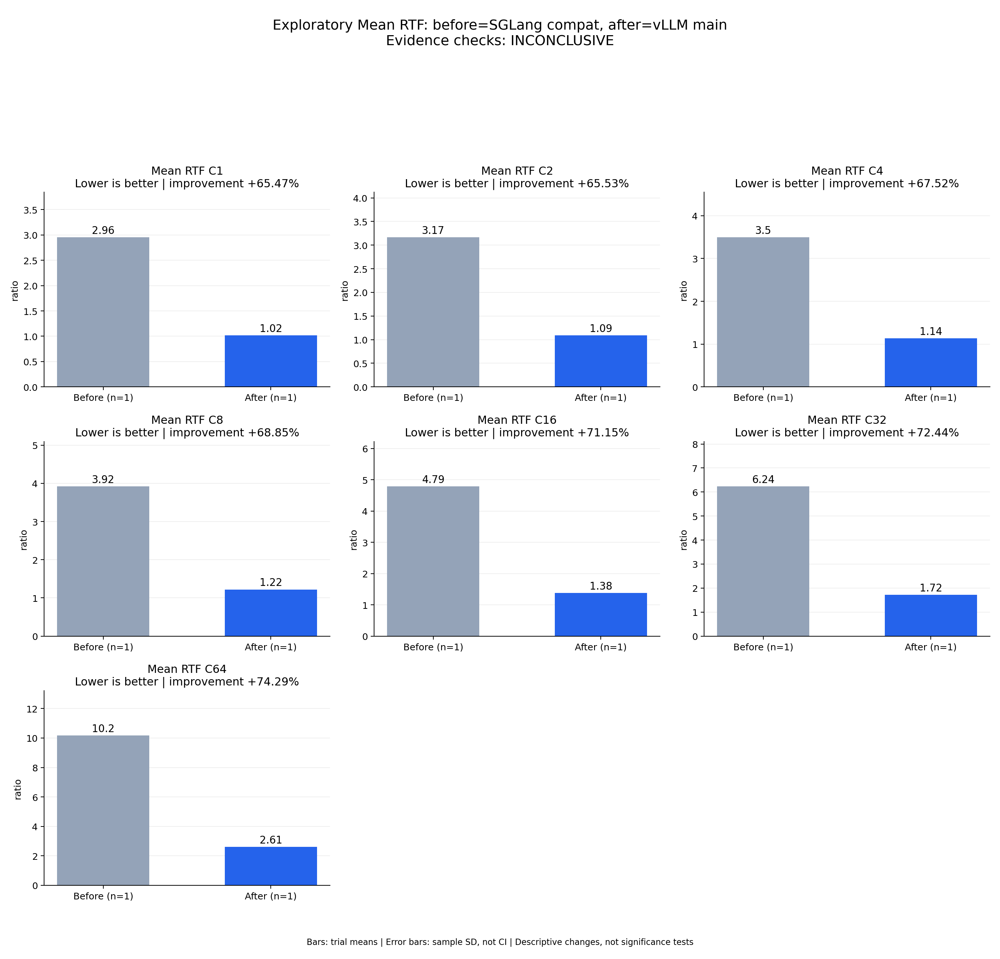

# Exploratory Mean RTF: before=SGLang compat, after=vLLM main

Evidence checks: **INCONCLUSIVE**

PASS means supplied evidence checks passed; it does not establish a statistically significant gain.
Means are equally weighted trial means. SD is sample standard deviation, not a confidence interval.

| Metric / scenario | Direction | Before mean ± SD (n) | After mean ± SD (n) | Improvement | Scope |
|---|---|---:|---:|---:|---|
| Mean RTF / C1 (ratio) | lower | 2.95682 ± N/A (n=1) | 1.02104 ± N/A (n=1) | +65.47% | single trial |
| Mean RTF / C2 (ratio) | lower | 3.16866 ± N/A (n=1) | 1.09211 ± N/A (n=1) | +65.53% | single trial |
| Mean RTF / C4 (ratio) | lower | 3.49845 ± N/A (n=1) | 1.13613 ± N/A (n=1) | +67.52% | single trial |
| Mean RTF / C8 (ratio) | lower | 3.92215 ± N/A (n=1) | 1.22169 ± N/A (n=1) | +68.85% | single trial |
| Mean RTF / C16 (ratio) | lower | 4.78953 ± N/A (n=1) | 1.38156 ± N/A (n=1) | +71.15% | single trial |
| Mean RTF / C32 (ratio) | lower | 6.23618 ± N/A (n=1) | 1.7185 ± N/A (n=1) | +72.44% | single trial |
| Mean RTF / C64 (ratio) | lower | 10.1708 ± N/A (n=1) | 2.61484 ± N/A (n=1) | +74.29% | single trial |



## Input and provenance

```json
{
  "title": "Exploratory Mean RTF: before=SGLang compat, after=vLLM main",
  "synthetic": false,
  "checks": {
    "comparable": "unknown",
    "correctness": "unknown",
    "lifecycle": "pass"
  },
  "runs": {
    "before": {
      "completed": 896,
      "failed": 0
    },
    "after": {
      "completed": 896,
      "failed": 0
    }
  },
  "provenance": {
    "before_revision": "6bdd47967caa55c38430d18175b750008aecab61",
    "after_revision": "b164fea797531c1fa10f8b87829632cad006b9fc",
    "device": "physical NPU 0 in separate sessions",
    "scope": "One exploratory trial per concurrency; shared host and different framework startup workarounds; no significance or 2x acceptance claim",
    "workload_sha256": "5007716c83b29d0247b2c6291b9704c652e01a94362c19e90ea3cb34987060c7"
  },
  "metrics": [
    {
      "name": "Mean RTF",
      "unit": "ratio",
      "direction": "lower",
      "scenario": "C1",
      "before": [
        2.9568215378457765
      ],
      "after": [
        1.021043179537028
      ]
    },
    {
      "name": "Mean RTF",
      "unit": "ratio",
      "direction": "lower",
      "scenario": "C2",
      "before": [
        3.168660684523214
      ],
      "after": [
        1.0921106427737464
      ]
    },
    {
      "name": "Mean RTF",
      "unit": "ratio",
      "direction": "lower",
      "scenario": "C4",
      "before": [
        3.498447874208937
      ],
      "after": [
        1.1361252515339015
      ]
    },
    {
      "name": "Mean RTF",
      "unit": "ratio",
      "direction": "lower",
      "scenario": "C8",
      "before": [
        3.922154499077724
      ],
      "after": [
        1.2216941816145934
      ]
    },
    {
      "name": "Mean RTF",
      "unit": "ratio",
      "direction": "lower",
      "scenario": "C16",
      "before": [
        4.789526350765899
      ],
      "after": [
        1.3815607495303417
      ]
    },
    {
      "name": "Mean RTF",
      "unit": "ratio",
      "direction": "lower",
      "scenario": "C32",
      "before": [
        6.236175363244542
      ],
      "after": [
        1.7184953824042835
      ]
    },
    {
      "name": "Mean RTF",
      "unit": "ratio",
      "direction": "lower",
      "scenario": "C64",
      "before": [
        10.170835155907064
      ],
      "after": [
        2.6148350119770956
      ]
    }
  ]
}
```
