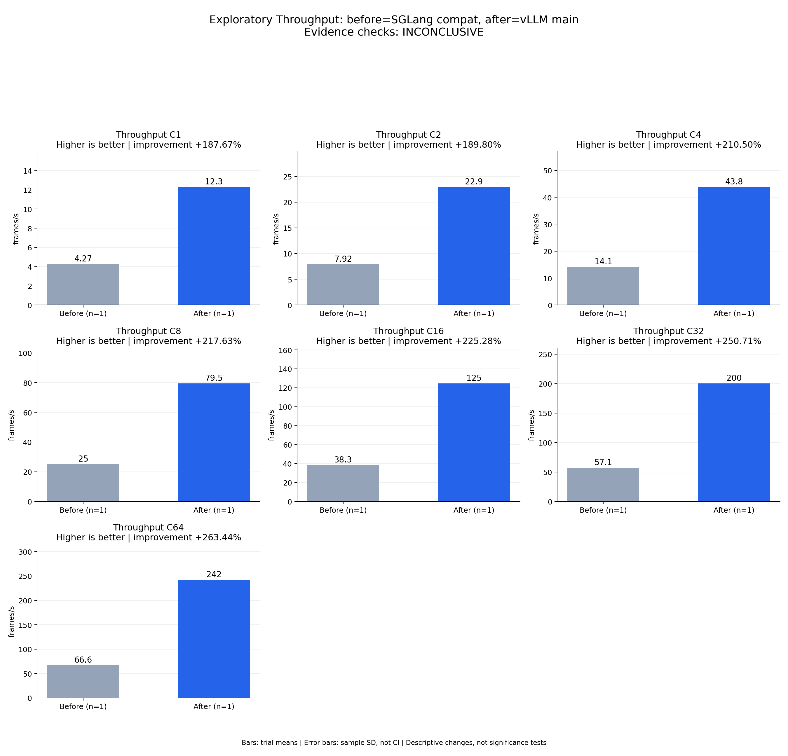

# Exploratory Throughput: before=SGLang compat, after=vLLM main

Evidence checks: **INCONCLUSIVE**

PASS means supplied evidence checks passed; it does not establish a statistically significant gain.
Means are equally weighted trial means. SD is sample standard deviation, not a confidence interval.

| Metric / scenario | Direction | Before mean ± SD (n) | After mean ± SD (n) | Improvement | Scope |
|---|---|---:|---:|---:|---|
| Throughput / C1 (frames/s) | higher | 4.27469 ± N/A (n=1) | 12.2968 ± N/A (n=1) | +187.67% | single trial |
| Throughput / C2 (frames/s) | higher | 7.91689 ± N/A (n=1) | 22.9432 ± N/A (n=1) | +189.80% | single trial |
| Throughput / C4 (frames/s) | higher | 14.1163 ± N/A (n=1) | 43.8313 ± N/A (n=1) | +210.50% | single trial |
| Throughput / C8 (frames/s) | higher | 25.0264 ± N/A (n=1) | 79.4908 ± N/A (n=1) | +217.63% | single trial |
| Throughput / C16 (frames/s) | higher | 38.3041 ± N/A (n=1) | 124.596 ± N/A (n=1) | +225.28% | single trial |
| Throughput / C32 (frames/s) | higher | 57.1021 ± N/A (n=1) | 200.265 ± N/A (n=1) | +250.71% | single trial |
| Throughput / C64 (frames/s) | higher | 66.6067 ± N/A (n=1) | 242.077 ± N/A (n=1) | +263.44% | single trial |



## Input and provenance

```json
{
  "title": "Exploratory Throughput: before=SGLang compat, after=vLLM main",
  "synthetic": false,
  "checks": {
    "comparable": "unknown",
    "correctness": "unknown",
    "lifecycle": "pass"
  },
  "runs": {
    "before": {
      "completed": 896,
      "failed": 0
    },
    "after": {
      "completed": 896,
      "failed": 0
    }
  },
  "provenance": {
    "before_revision": "6bdd47967caa55c38430d18175b750008aecab61",
    "after_revision": "b164fea797531c1fa10f8b87829632cad006b9fc",
    "device": "physical NPU 0 in separate sessions",
    "scope": "One exploratory trial per concurrency; shared host and different framework startup workarounds; no significance or 2x acceptance claim",
    "workload_sha256": "5007716c83b29d0247b2c6291b9704c652e01a94362c19e90ea3cb34987060c7"
  },
  "metrics": [
    {
      "name": "Throughput",
      "unit": "frames/s",
      "direction": "higher",
      "scenario": "C1",
      "before": [
        4.274688133704026
      ],
      "after": [
        12.296847685489093
      ]
    },
    {
      "name": "Throughput",
      "unit": "frames/s",
      "direction": "higher",
      "scenario": "C2",
      "before": [
        7.916893521882779
      ],
      "after": [
        22.943153962655607
      ]
    },
    {
      "name": "Throughput",
      "unit": "frames/s",
      "direction": "higher",
      "scenario": "C4",
      "before": [
        14.116271131187982
      ],
      "after": [
        43.83126223034298
      ]
    },
    {
      "name": "Throughput",
      "unit": "frames/s",
      "direction": "higher",
      "scenario": "C8",
      "before": [
        25.02642936804738
      ],
      "after": [
        79.49077891672454
      ]
    },
    {
      "name": "Throughput",
      "unit": "frames/s",
      "direction": "higher",
      "scenario": "C16",
      "before": [
        38.30413736825286
      ],
      "after": [
        124.59641583494476
      ]
    },
    {
      "name": "Throughput",
      "unit": "frames/s",
      "direction": "higher",
      "scenario": "C32",
      "before": [
        57.10208034098629
      ],
      "after": [
        200.26527505533156
      ]
    },
    {
      "name": "Throughput",
      "unit": "frames/s",
      "direction": "higher",
      "scenario": "C64",
      "before": [
        66.60674902518353
      ],
      "after": [
        242.0768702666381
      ]
    }
  ]
}
```
