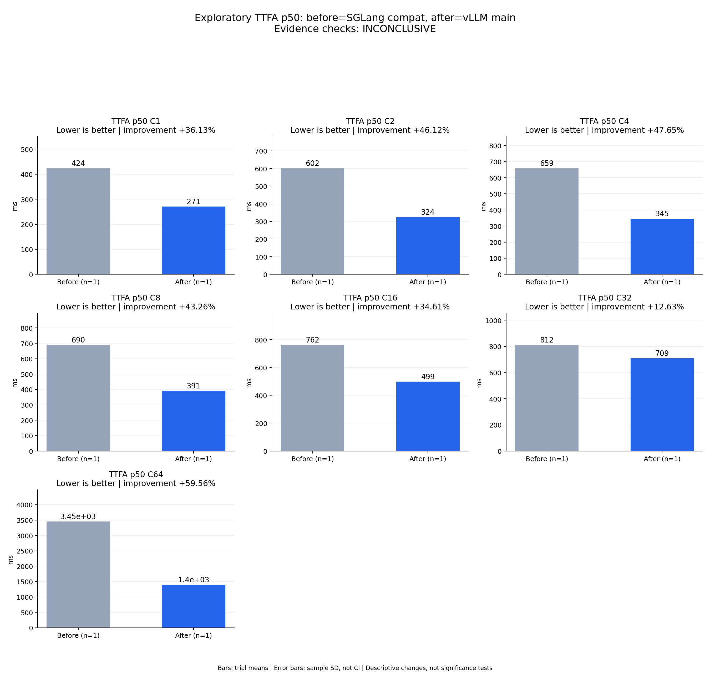

# Exploratory TTFA p50: before=SGLang compat, after=vLLM main

Evidence checks: **INCONCLUSIVE**

PASS means supplied evidence checks passed; it does not establish a statistically significant gain.
Means are equally weighted trial means. SD is sample standard deviation, not a confidence interval.

| Metric / scenario | Direction | Before mean ± SD (n) | After mean ± SD (n) | Improvement | Scope |
|---|---|---:|---:|---:|---|
| TTFA p50 / C1 (ms) | lower | 424.172 ± N/A (n=1) | 270.93 ± N/A (n=1) | +36.13% | single trial |
| TTFA p50 / C2 (ms) | lower | 601.963 ± N/A (n=1) | 324.362 ± N/A (n=1) | +46.12% | single trial |
| TTFA p50 / C4 (ms) | lower | 658.992 ± N/A (n=1) | 344.957 ± N/A (n=1) | +47.65% | single trial |
| TTFA p50 / C8 (ms) | lower | 689.92 ± N/A (n=1) | 391.494 ± N/A (n=1) | +43.26% | single trial |
| TTFA p50 / C16 (ms) | lower | 762.42 ± N/A (n=1) | 498.533 ± N/A (n=1) | +34.61% | single trial |
| TTFA p50 / C32 (ms) | lower | 811.746 ± N/A (n=1) | 709.218 ± N/A (n=1) | +12.63% | single trial |
| TTFA p50 / C64 (ms) | lower | 3451.91 ± N/A (n=1) | 1395.92 ± N/A (n=1) | +59.56% | single trial |



## Input and provenance

```json
{
  "title": "Exploratory TTFA p50: before=SGLang compat, after=vLLM main",
  "synthetic": false,
  "checks": {
    "comparable": "unknown",
    "correctness": "unknown",
    "lifecycle": "pass"
  },
  "runs": {
    "before": {
      "completed": 896,
      "failed": 0
    },
    "after": {
      "completed": 896,
      "failed": 0
    }
  },
  "provenance": {
    "before_revision": "6bdd47967caa55c38430d18175b750008aecab61",
    "after_revision": "b164fea797531c1fa10f8b87829632cad006b9fc",
    "device": "physical NPU 0 in separate sessions",
    "scope": "One exploratory trial per concurrency; shared host and different framework startup workarounds; no significance or 2x acceptance claim",
    "workload_sha256": "5007716c83b29d0247b2c6291b9704c652e01a94362c19e90ea3cb34987060c7"
  },
  "metrics": [
    {
      "name": "TTFA p50",
      "unit": "ms",
      "direction": "lower",
      "scenario": "C1",
      "before": [
        424.1716735996306
      ],
      "after": [
        270.9299558773637
      ]
    },
    {
      "name": "TTFA p50",
      "unit": "ms",
      "direction": "lower",
      "scenario": "C2",
      "before": [
        601.9626688212156
      ],
      "after": [
        324.36227006837726
      ]
    },
    {
      "name": "TTFA p50",
      "unit": "ms",
      "direction": "lower",
      "scenario": "C4",
      "before": [
        658.9919766411185
      ],
      "after": [
        344.9574699625373
      ]
    },
    {
      "name": "TTFA p50",
      "unit": "ms",
      "direction": "lower",
      "scenario": "C8",
      "before": [
        689.9198177270591
      ],
      "after": [
        391.4935803040862
      ]
    },
    {
      "name": "TTFA p50",
      "unit": "ms",
      "direction": "lower",
      "scenario": "C16",
      "before": [
        762.419527862221
      ],
      "after": [
        498.53252014145255
      ]
    },
    {
      "name": "TTFA p50",
      "unit": "ms",
      "direction": "lower",
      "scenario": "C32",
      "before": [
        811.7464822717011
      ],
      "after": [
        709.2177751474082
      ]
    },
    {
      "name": "TTFA p50",
      "unit": "ms",
      "direction": "lower",
      "scenario": "C64",
      "before": [
        3451.91464247182
      ],
      "after": [
        1395.918546244502
      ]
    }
  ]
}
```
