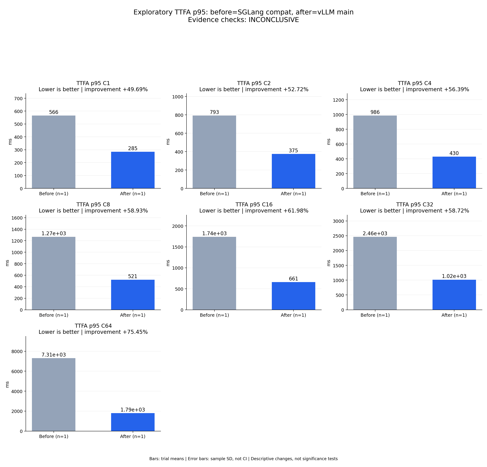

# Exploratory TTFA p95: before=SGLang compat, after=vLLM main

Evidence checks: **INCONCLUSIVE**

PASS means supplied evidence checks passed; it does not establish a statistically significant gain.
Means are equally weighted trial means. SD is sample standard deviation, not a confidence interval.

| Metric / scenario | Direction | Before mean ± SD (n) | After mean ± SD (n) | Improvement | Scope |
|---|---|---:|---:|---:|---|
| TTFA p95 / C1 (ms) | lower | 565.993 ± N/A (n=1) | 284.757 ± N/A (n=1) | +49.69% | single trial |
| TTFA p95 / C2 (ms) | lower | 793.136 ± N/A (n=1) | 374.999 ± N/A (n=1) | +52.72% | single trial |
| TTFA p95 / C4 (ms) | lower | 986.292 ± N/A (n=1) | 430.125 ± N/A (n=1) | +56.39% | single trial |
| TTFA p95 / C8 (ms) | lower | 1267.35 ± N/A (n=1) | 520.529 ± N/A (n=1) | +58.93% | single trial |
| TTFA p95 / C16 (ms) | lower | 1739.05 ± N/A (n=1) | 661.137 ± N/A (n=1) | +61.98% | single trial |
| TTFA p95 / C32 (ms) | lower | 2462.35 ± N/A (n=1) | 1016.53 ± N/A (n=1) | +58.72% | single trial |
| TTFA p95 / C64 (ms) | lower | 7305.23 ± N/A (n=1) | 1793.43 ± N/A (n=1) | +75.45% | single trial |



## Input and provenance

```json
{
  "title": "Exploratory TTFA p95: before=SGLang compat, after=vLLM main",
  "synthetic": false,
  "checks": {
    "comparable": "unknown",
    "correctness": "unknown",
    "lifecycle": "pass"
  },
  "runs": {
    "before": {
      "completed": 896,
      "failed": 0
    },
    "after": {
      "completed": 896,
      "failed": 0
    }
  },
  "provenance": {
    "before_revision": "6bdd47967caa55c38430d18175b750008aecab61",
    "after_revision": "b164fea797531c1fa10f8b87829632cad006b9fc",
    "device": "physical NPU 0 in separate sessions",
    "scope": "One exploratory trial per concurrency; shared host and different framework startup workarounds; no significance or 2x acceptance claim",
    "workload_sha256": "5007716c83b29d0247b2c6291b9704c652e01a94362c19e90ea3cb34987060c7"
  },
  "metrics": [
    {
      "name": "TTFA p95",
      "unit": "ms",
      "direction": "lower",
      "scenario": "C1",
      "before": [
        565.9927828237414
      ],
      "after": [
        284.75743043236434
      ]
    },
    {
      "name": "TTFA p95",
      "unit": "ms",
      "direction": "lower",
      "scenario": "C2",
      "before": [
        793.1363265495747
      ],
      "after": [
        374.9993046745658
      ]
    },
    {
      "name": "TTFA p95",
      "unit": "ms",
      "direction": "lower",
      "scenario": "C4",
      "before": [
        986.2919033970683
      ],
      "after": [
        430.1252225879579
      ]
    },
    {
      "name": "TTFA p95",
      "unit": "ms",
      "direction": "lower",
      "scenario": "C8",
      "before": [
        1267.3496592789882
      ],
      "after": [
        520.5294966232032
      ]
    },
    {
      "name": "TTFA p95",
      "unit": "ms",
      "direction": "lower",
      "scenario": "C16",
      "before": [
        1739.0456179156897
      ],
      "after": [
        661.1373523715883
      ]
    },
    {
      "name": "TTFA p95",
      "unit": "ms",
      "direction": "lower",
      "scenario": "C32",
      "before": [
        2462.347258720547
      ],
      "after": [
        1016.5279964916408
      ]
    },
    {
      "name": "TTFA p95",
      "unit": "ms",
      "direction": "lower",
      "scenario": "C64",
      "before": [
        7305.230406951158
      ],
      "after": [
        1793.4304440394044
      ]
    }
  ]
}
```
