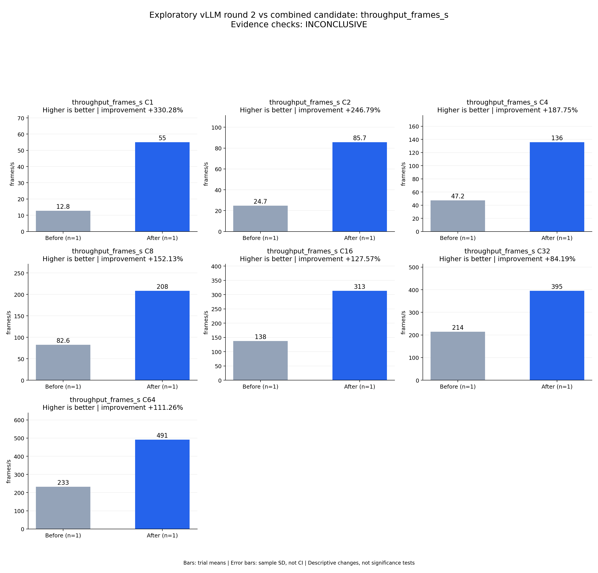

# Exploratory vLLM round 2 vs combined candidate: throughput_frames_s

Evidence checks: **INCONCLUSIVE**

PASS means supplied evidence checks passed; it does not establish a statistically significant gain.
Means are equally weighted trial means. SD is sample standard deviation, not a confidence interval.

| Metric / scenario | Direction | Before mean ± SD (n) | After mean ± SD (n) | Improvement | Scope |
|---|---|---:|---:|---:|---|
| throughput_frames_s / C1 (frames/s) | higher | 12.7911 ± N/A (n=1) | 55.0375 ± N/A (n=1) | +330.28% | single trial |
| throughput_frames_s / C2 (frames/s) | higher | 24.7124 ± N/A (n=1) | 85.701 ± N/A (n=1) | +246.79% | single trial |
| throughput_frames_s / C4 (frames/s) | higher | 47.1928 ± N/A (n=1) | 135.796 ± N/A (n=1) | +187.75% | single trial |
| throughput_frames_s / C8 (frames/s) | higher | 82.576 ± N/A (n=1) | 208.199 ± N/A (n=1) | +152.13% | single trial |
| throughput_frames_s / C16 (frames/s) | higher | 137.542 ± N/A (n=1) | 313.009 ± N/A (n=1) | +127.57% | single trial |
| throughput_frames_s / C32 (frames/s) | higher | 214.294 ± N/A (n=1) | 394.717 ± N/A (n=1) | +84.19% | single trial |
| throughput_frames_s / C64 (frames/s) | higher | 232.6 ± N/A (n=1) | 491.399 ± N/A (n=1) | +111.26% | single trial |



## Input and provenance

```json
{
  "title": "Exploratory vLLM round 2 vs combined candidate: throughput_frames_s",
  "synthetic": false,
  "context": {
    "hardware": "One Ascend 910B1 per arm; baseline physical device 0, candidate physical device 6; shared host",
    "model": "Qwen3-TTS-12Hz-1.7B-CustomVoice BF16",
    "workload_sha256": "5007716c83b29d0247b2c6291b9704c652e01a94362c19e90ea3cb34987060c7",
    "baseline_revision": "b164fea797531c1fa10f8b87829632cad006b9fc",
    "candidate_revision": "a9fac0663b1ee2923c6d3dc007f2b5f408457765",
    "source_logs": [
      "runs/vllm-sweep-round2-full128/status.json",
      "runs/continuous-codec-fused-predictor-rope-full/status.json"
    ],
    "timing_scope": "Warm service, client dispatch through terminal PCM event; TTFA first nonempty PCM"
  },
  "checks": {
    "comparable": "unknown",
    "correctness": "unknown",
    "lifecycle": "pass"
  },
  "runs": {
    "before": {
      "completed": 896,
      "failed": 0
    },
    "after": {
      "completed": 896,
      "failed": 0
    }
  },
  "notes": [
    "One independent trial per arm; no error bars or significance claim.",
    "Comparison is with vLLM round 2, not final selection across three repeats of both frameworks.",
    "All candidate ASR gates pass against round-1 baselines; speaker evaluation and round-2 matched quality remain incomplete.",
    "C32 candidate throughput is 1.842x this baseline, below the required 2x.",
    "Both services exited 0; shared-host and device variability remain uncontrolled."
  ],
  "metrics": [
    {
      "name": "throughput_frames_s",
      "unit": "frames/s",
      "direction": "higher",
      "scenario": "C1",
      "before": [
        12.791066544709883
      ],
      "after": [
        55.03751509831964
      ]
    },
    {
      "name": "throughput_frames_s",
      "unit": "frames/s",
      "direction": "higher",
      "scenario": "C2",
      "before": [
        24.712437230161637
      ],
      "after": [
        85.70104040440229
      ]
    },
    {
      "name": "throughput_frames_s",
      "unit": "frames/s",
      "direction": "higher",
      "scenario": "C4",
      "before": [
        47.19281370410862
      ],
      "after": [
        135.79574279564076
      ]
    },
    {
      "name": "throughput_frames_s",
      "unit": "frames/s",
      "direction": "higher",
      "scenario": "C8",
      "before": [
        82.57597590962091
      ],
      "after": [
        208.1993007486102
      ]
    },
    {
      "name": "throughput_frames_s",
      "unit": "frames/s",
      "direction": "higher",
      "scenario": "C16",
      "before": [
        137.54177906611915
      ],
      "after": [
        313.0087305435317
      ]
    },
    {
      "name": "throughput_frames_s",
      "unit": "frames/s",
      "direction": "higher",
      "scenario": "C32",
      "before": [
        214.29404211656257
      ],
      "after": [
        394.716932584896
      ]
    },
    {
      "name": "throughput_frames_s",
      "unit": "frames/s",
      "direction": "higher",
      "scenario": "C64",
      "before": [
        232.5999250066449
      ],
      "after": [
        491.3987635987143
      ]
    }
  ]
}
```
