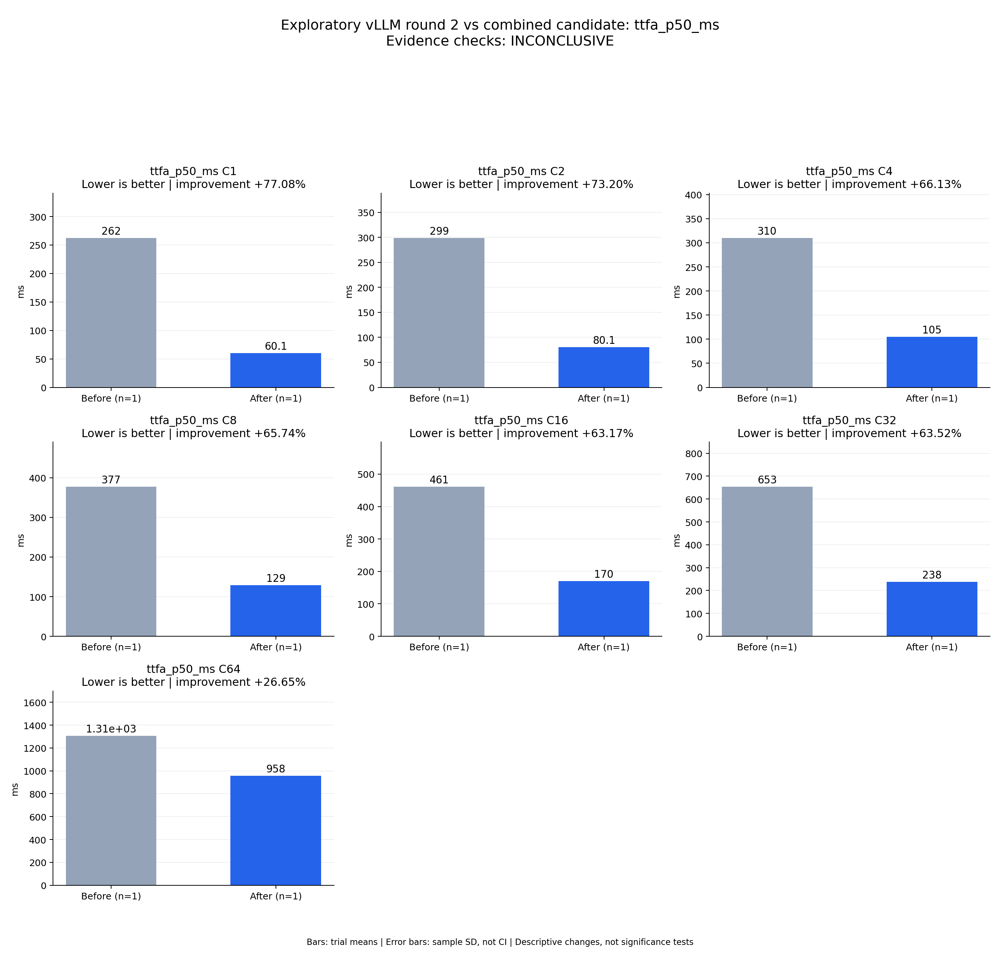

# Exploratory vLLM round 2 vs combined candidate: ttfa_p50_ms

Evidence checks: **INCONCLUSIVE**

PASS means supplied evidence checks passed; it does not establish a statistically significant gain.
Means are equally weighted trial means. SD is sample standard deviation, not a confidence interval.

| Metric / scenario | Direction | Before mean ± SD (n) | After mean ± SD (n) | Improvement | Scope |
|---|---|---:|---:|---:|---|
| ttfa_p50_ms / C1 (ms) | lower | 262.43 ± N/A (n=1) | 60.1472 ± N/A (n=1) | +77.08% | single trial |
| ttfa_p50_ms / C2 (ms) | lower | 298.858 ± N/A (n=1) | 80.0982 ± N/A (n=1) | +73.20% | single trial |
| ttfa_p50_ms / C4 (ms) | lower | 310.106 ± N/A (n=1) | 105.045 ± N/A (n=1) | +66.13% | single trial |
| ttfa_p50_ms / C8 (ms) | lower | 377.037 ± N/A (n=1) | 129.173 ± N/A (n=1) | +65.74% | single trial |
| ttfa_p50_ms / C16 (ms) | lower | 460.629 ± N/A (n=1) | 169.631 ± N/A (n=1) | +63.17% | single trial |
| ttfa_p50_ms / C32 (ms) | lower | 653.169 ± N/A (n=1) | 238.272 ± N/A (n=1) | +63.52% | single trial |
| ttfa_p50_ms / C64 (ms) | lower | 1306.11 ± N/A (n=1) | 957.982 ± N/A (n=1) | +26.65% | single trial |



## Input and provenance

```json
{
  "title": "Exploratory vLLM round 2 vs combined candidate: ttfa_p50_ms",
  "synthetic": false,
  "context": {
    "hardware": "One Ascend 910B1 per arm; baseline physical device 0, candidate physical device 6; shared host",
    "model": "Qwen3-TTS-12Hz-1.7B-CustomVoice BF16",
    "workload_sha256": "5007716c83b29d0247b2c6291b9704c652e01a94362c19e90ea3cb34987060c7",
    "baseline_revision": "b164fea797531c1fa10f8b87829632cad006b9fc",
    "candidate_revision": "a9fac0663b1ee2923c6d3dc007f2b5f408457765",
    "source_logs": [
      "runs/vllm-sweep-round2-full128/status.json",
      "runs/continuous-codec-fused-predictor-rope-full/status.json"
    ],
    "timing_scope": "Warm service, client dispatch through terminal PCM event; TTFA first nonempty PCM"
  },
  "checks": {
    "comparable": "unknown",
    "correctness": "unknown",
    "lifecycle": "pass"
  },
  "runs": {
    "before": {
      "completed": 896,
      "failed": 0
    },
    "after": {
      "completed": 896,
      "failed": 0
    }
  },
  "notes": [
    "One independent trial per arm; no error bars or significance claim.",
    "Comparison is with vLLM round 2, not final selection across three repeats of both frameworks.",
    "All candidate ASR gates pass against round-1 baselines; speaker evaluation and round-2 matched quality remain incomplete.",
    "C32 candidate throughput is 1.842x this baseline, below the required 2x.",
    "Both services exited 0; shared-host and device variability remain uncontrolled."
  ],
  "metrics": [
    {
      "name": "ttfa_p50_ms",
      "unit": "ms",
      "direction": "lower",
      "scenario": "C1",
      "before": [
        262.4301319010556
      ],
      "after": [
        60.14720629900694
      ]
    },
    {
      "name": "ttfa_p50_ms",
      "unit": "ms",
      "direction": "lower",
      "scenario": "C2",
      "before": [
        298.85789612308145
      ],
      "after": [
        80.09816333651543
      ]
    },
    {
      "name": "ttfa_p50_ms",
      "unit": "ms",
      "direction": "lower",
      "scenario": "C4",
      "before": [
        310.1064171642065
      ],
      "after": [
        105.04452930763364
      ]
    },
    {
      "name": "ttfa_p50_ms",
      "unit": "ms",
      "direction": "lower",
      "scenario": "C8",
      "before": [
        377.03682528808713
      ],
      "after": [
        129.17255889624357
      ]
    },
    {
      "name": "ttfa_p50_ms",
      "unit": "ms",
      "direction": "lower",
      "scenario": "C16",
      "before": [
        460.62856959179044
      ],
      "after": [
        169.63129211217165
      ]
    },
    {
      "name": "ttfa_p50_ms",
      "unit": "ms",
      "direction": "lower",
      "scenario": "C32",
      "before": [
        653.169259428978
      ],
      "after": [
        238.27150370925665
      ]
    },
    {
      "name": "ttfa_p50_ms",
      "unit": "ms",
      "direction": "lower",
      "scenario": "C64",
      "before": [
        1306.1149627901614
      ],
      "after": [
        957.9819859936833
      ]
    }
  ]
}
```
