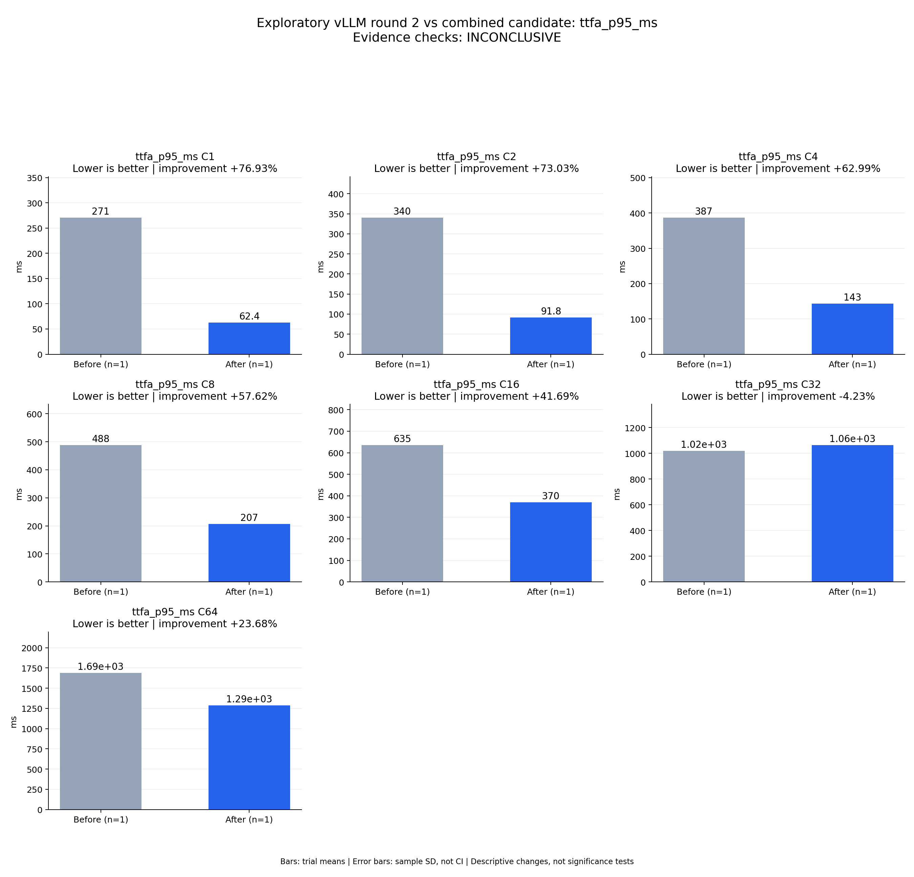

# Exploratory vLLM round 2 vs combined candidate: ttfa_p95_ms

Evidence checks: **INCONCLUSIVE**

PASS means supplied evidence checks passed; it does not establish a statistically significant gain.
Means are equally weighted trial means. SD is sample standard deviation, not a confidence interval.

| Metric / scenario | Direction | Before mean ± SD (n) | After mean ± SD (n) | Improvement | Scope |
|---|---|---:|---:|---:|---|
| ttfa_p95_ms / C1 (ms) | lower | 270.687 ± N/A (n=1) | 62.4424 ± N/A (n=1) | +76.93% | single trial |
| ttfa_p95_ms / C2 (ms) | lower | 340.479 ± N/A (n=1) | 91.8172 ± N/A (n=1) | +73.03% | single trial |
| ttfa_p95_ms / C4 (ms) | lower | 387.025 ± N/A (n=1) | 143.229 ± N/A (n=1) | +62.99% | single trial |
| ttfa_p95_ms / C8 (ms) | lower | 487.538 ± N/A (n=1) | 206.637 ± N/A (n=1) | +57.62% | single trial |
| ttfa_p95_ms / C16 (ms) | lower | 634.795 ± N/A (n=1) | 370.126 ± N/A (n=1) | +41.69% | single trial |
| ttfa_p95_ms / C32 (ms) | lower | 1019.09 ± N/A (n=1) | 1062.22 ± N/A (n=1) | -4.23% | single trial |
| ttfa_p95_ms / C64 (ms) | lower | 1688.38 ± N/A (n=1) | 1288.57 ± N/A (n=1) | +23.68% | single trial |



## Input and provenance

```json
{
  "title": "Exploratory vLLM round 2 vs combined candidate: ttfa_p95_ms",
  "synthetic": false,
  "context": {
    "hardware": "One Ascend 910B1 per arm; baseline physical device 0, candidate physical device 6; shared host",
    "model": "Qwen3-TTS-12Hz-1.7B-CustomVoice BF16",
    "workload_sha256": "5007716c83b29d0247b2c6291b9704c652e01a94362c19e90ea3cb34987060c7",
    "baseline_revision": "b164fea797531c1fa10f8b87829632cad006b9fc",
    "candidate_revision": "a9fac0663b1ee2923c6d3dc007f2b5f408457765",
    "source_logs": [
      "runs/vllm-sweep-round2-full128/status.json",
      "runs/continuous-codec-fused-predictor-rope-full/status.json"
    ],
    "timing_scope": "Warm service, client dispatch through terminal PCM event; TTFA first nonempty PCM"
  },
  "checks": {
    "comparable": "unknown",
    "correctness": "unknown",
    "lifecycle": "pass"
  },
  "runs": {
    "before": {
      "completed": 896,
      "failed": 0
    },
    "after": {
      "completed": 896,
      "failed": 0
    }
  },
  "notes": [
    "One independent trial per arm; no error bars or significance claim.",
    "Comparison is with vLLM round 2, not final selection across three repeats of both frameworks.",
    "All candidate ASR gates pass against round-1 baselines; speaker evaluation and round-2 matched quality remain incomplete.",
    "C32 candidate throughput is 1.842x this baseline, below the required 2x.",
    "Both services exited 0; shared-host and device variability remain uncontrolled."
  ],
  "metrics": [
    {
      "name": "ttfa_p95_ms",
      "unit": "ms",
      "direction": "lower",
      "scenario": "C1",
      "before": [
        270.6865864805877
      ],
      "after": [
        62.44243532419205
      ]
    },
    {
      "name": "ttfa_p95_ms",
      "unit": "ms",
      "direction": "lower",
      "scenario": "C2",
      "before": [
        340.47881476581097
      ],
      "after": [
        91.81718570180236
      ]
    },
    {
      "name": "ttfa_p95_ms",
      "unit": "ms",
      "direction": "lower",
      "scenario": "C4",
      "before": [
        387.02510218136007
      ],
      "after": [
        143.228876357898
      ]
    },
    {
      "name": "ttfa_p95_ms",
      "unit": "ms",
      "direction": "lower",
      "scenario": "C8",
      "before": [
        487.53843032754946
      ],
      "after": [
        206.63701184093924
      ]
    },
    {
      "name": "ttfa_p95_ms",
      "unit": "ms",
      "direction": "lower",
      "scenario": "C16",
      "before": [
        634.7947570495307
      ],
      "after": [
        370.12574193067843
      ]
    },
    {
      "name": "ttfa_p95_ms",
      "unit": "ms",
      "direction": "lower",
      "scenario": "C32",
      "before": [
        1019.0857470035553
      ],
      "after": [
        1062.2166921384633
      ]
    },
    {
      "name": "ttfa_p95_ms",
      "unit": "ms",
      "direction": "lower",
      "scenario": "C64",
      "before": [
        1688.375543570146
      ],
      "after": [
        1288.5734409559518
      ]
    }
  ]
}
```
