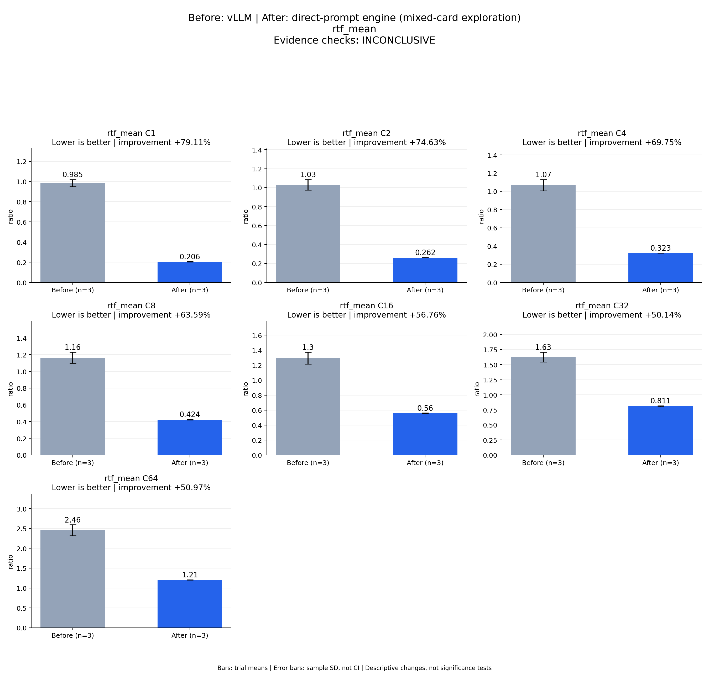

# Before: vLLM | After: direct-prompt engine (mixed-card exploration)
rtf_mean

Evidence checks: **INCONCLUSIVE**

PASS means supplied evidence checks passed; it does not establish a statistically significant gain.
Means are equally weighted trial means. SD is sample standard deviation, not a confidence interval.

| Metric / scenario | Direction | Before mean ± SD (n) | After mean ± SD (n) | Improvement | Scope |
|---|---|---:|---:|---:|---|
| rtf_mean / C1 (ratio) | lower | 0.985019 ± 0.0346894 (n=3) | 0.205777 ± 0.00152144 (n=3) | +79.11% | repeated trials |
| rtf_mean / C2 (ratio) | lower | 1.03063 ± 0.0553252 (n=3) | 0.261516 ± 0.00164696 (n=3) | +74.63% | repeated trials |
| rtf_mean / C4 (ratio) | lower | 1.06798 ± 0.0617198 (n=3) | 0.323093 ± 0.0011166 (n=3) | +69.75% | repeated trials |
| rtf_mean / C8 (ratio) | lower | 1.16354 ± 0.0671377 (n=3) | 0.423604 ± 0.00223825 (n=3) | +63.59% | repeated trials |
| rtf_mean / C16 (ratio) | lower | 1.29513 ± 0.0791422 (n=3) | 0.55998 ± 0.00238409 (n=3) | +56.76% | repeated trials |
| rtf_mean / C32 (ratio) | lower | 1.62592 ± 0.0807 (n=3) | 0.810649 ± 0.00589311 (n=3) | +50.14% | repeated trials |
| rtf_mean / C64 (ratio) | lower | 2.45932 ± 0.136161 (n=3) | 1.20588 ± 0.00376544 (n=3) | +50.97% | repeated trials |



## Input and provenance

```json
{
  "title": "Before: vLLM | After: direct-prompt engine (mixed-card exploration)\nrtf_mean",
  "synthetic": false,
  "context": {
    "hardware": "Ascend 910B1; candidate physical NPU 6; vLLM trials 1/2 NPU 0, trial 3 NPU 1; shared host",
    "model": "Qwen3-TTS-12Hz-1.7B-CustomVoice BF16, pinned weights",
    "workload": "128 fixed requests at each C1/2/4/8/16/32/64",
    "baseline_revision": [
      "b164fea797531c1fa10f8b87829632cad006b9fc",
      "b164fea797531c1fa10f8b87829632cad006b9fc",
      "b164fea797531c1fa10f8b87829632cad006b9fc"
    ],
    "candidate_revision": [
      "e783a64b0fb4f9ade2ffb3980b3e1f74a00c9a6a",
      "e783a64b0fb4f9ade2ffb3980b3e1f74a00c9a6a",
      "e783a64b0fb4f9ade2ffb3980b3e1f74a00c9a6a"
    ],
    "source_logs": [
      "runs/vllm-sweep-round1-full128/status.json",
      "runs/vllm-sweep-round2-full128/status.json",
      "runs/vllm-sweep-round3-full128/status.json",
      "runs/continuous-direct-prompt-full-round1/status.json",
      "runs/continuous-direct-prompt-full-round2/status.json",
      "runs/continuous-direct-prompt-full-round3/status.json"
    ]
  },
  "checks": {
    "comparable": "unknown",
    "correctness": "unknown",
    "lifecycle": "pass"
  },
  "runs": {
    "before": {
      "completed": 2688,
      "failed": 0
    },
    "after": {
      "completed": 2688,
      "failed": 0
    }
  },
  "notes": [
    "Three independent processes per arm; bars are means and error bars sample standard deviations, not confidence intervals.",
    "Mixed physical cards and shared-host conditions prevent final acceptance from this figure.",
    "Candidate independent scoring is incomplete; all candidate repeat WAVs match trial 1, recorded separately.",
    "TTFA p50/p95 bars summarize per-trial percentile statistics; they are not pooled-request percentiles.",
    "This is a vLLM comparison only; final same-card three-framework validation remains pending."
  ],
  "metrics": [
    {
      "name": "rtf_mean",
      "unit": "ratio",
      "direction": "lower",
      "scenario": "C1",
      "before": [
        1.021043179537028,
        0.982175721115547,
        0.9518393844746192
      ],
      "after": [
        0.2040202713525727,
        0.20662265314419292,
        0.2066871247521272
      ]
    },
    {
      "name": "rtf_mean",
      "unit": "ratio",
      "direction": "lower",
      "scenario": "C2",
      "before": [
        1.0921106427737464,
        1.0149255174912346,
        0.9848559281382632
      ],
      "after": [
        0.2596918090578549,
        0.26196390608792497,
        0.26289319114830956
      ]
    },
    {
      "name": "rtf_mean",
      "unit": "ratio",
      "direction": "lower",
      "scenario": "C4",
      "before": [
        1.1361252515339015,
        1.0519599005503668,
        1.0158431113123076
      ],
      "after": [
        0.3218227075685166,
        0.3235379359199685,
        0.3239188105316727
      ]
    },
    {
      "name": "rtf_mean",
      "unit": "ratio",
      "direction": "lower",
      "scenario": "C8",
      "before": [
        1.2216941816145934,
        1.1788510196547728,
        1.0900648017357981
      ],
      "after": [
        0.42183961514073637,
        0.426121731651371,
        0.42285065021065915
      ]
    },
    {
      "name": "rtf_mean",
      "unit": "ratio",
      "direction": "lower",
      "scenario": "C16",
      "before": [
        1.3815607495303417,
        1.2776324467121596,
        1.2262058547836423
      ],
      "after": [
        0.5589002492353429,
        0.5583264150459066,
        0.5627126802757001
      ]
    },
    {
      "name": "rtf_mean",
      "unit": "ratio",
      "direction": "lower",
      "scenario": "C32",
      "before": [
        1.7184953824042835,
        1.5888183318249476,
        1.5704379832437827
      ],
      "after": [
        0.8038481906396602,
        0.8138480041123299,
        0.8142507876641896
      ]
    },
    {
      "name": "rtf_mean",
      "unit": "ratio",
      "direction": "lower",
      "scenario": "C64",
      "before": [
        2.6148350119770956,
        2.4016064005608397,
        2.361524938811907
      ],
      "after": [
        1.202063684910961,
        1.205982553243251,
        1.2095924447049458
      ]
    }
  ]
}
```
