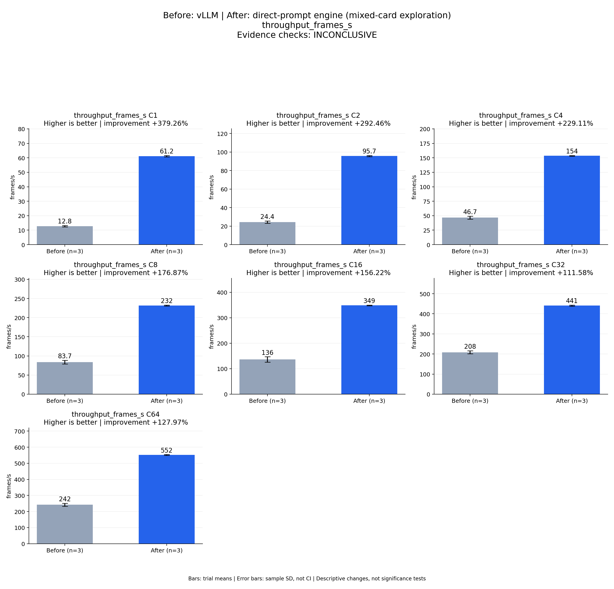

# Before: vLLM | After: direct-prompt engine (mixed-card exploration)
throughput_frames_s

Evidence checks: **INCONCLUSIVE**

PASS means supplied evidence checks passed; it does not establish a statistically significant gain.
Means are equally weighted trial means. SD is sample standard deviation, not a confidence interval.

| Metric / scenario | Direction | Before mean ± SD (n) | After mean ± SD (n) | Improvement | Scope |
|---|---|---:|---:|---:|---|
| throughput_frames_s / C1 (frames/s) | higher | 12.7631 ± 0.452924 (n=3) | 61.1683 ± 0.467486 (n=3) | +379.26% | repeated trials |
| throughput_frames_s / C2 (frames/s) | higher | 24.3812 ± 1.30439 (n=3) | 95.6875 ± 0.618087 (n=3) | +292.46% | repeated trials |
| throughput_frames_s / C4 (frames/s) | higher | 46.6501 ± 2.59045 (n=3) | 153.532 ± 0.534593 (n=3) | +229.11% | repeated trials |
| throughput_frames_s / C8 (frames/s) | higher | 83.7317 ± 4.9217 (n=3) | 231.827 ± 1.24617 (n=3) | +176.87% | repeated trials |
| throughput_frames_s / C16 (frames/s) | higher | 136.018 ± 10.7411 (n=3) | 348.505 ± 1.44376 (n=3) | +156.22% | repeated trials |
| throughput_frames_s / C32 (frames/s) | higher | 208.428 ± 7.29076 (n=3) | 440.989 ± 2.88001 (n=3) | +111.58% | repeated trials |
| throughput_frames_s / C64 (frames/s) | higher | 242.106 ± 9.52077 (n=3) | 551.939 ± 2.26475 (n=3) | +127.97% | repeated trials |



## Input and provenance

```json
{
  "title": "Before: vLLM | After: direct-prompt engine (mixed-card exploration)\nthroughput_frames_s",
  "synthetic": false,
  "context": {
    "hardware": "Ascend 910B1; candidate physical NPU 6; vLLM trials 1/2 NPU 0, trial 3 NPU 1; shared host",
    "model": "Qwen3-TTS-12Hz-1.7B-CustomVoice BF16, pinned weights",
    "workload": "128 fixed requests at each C1/2/4/8/16/32/64",
    "baseline_revision": [
      "b164fea797531c1fa10f8b87829632cad006b9fc",
      "b164fea797531c1fa10f8b87829632cad006b9fc",
      "b164fea797531c1fa10f8b87829632cad006b9fc"
    ],
    "candidate_revision": [
      "e783a64b0fb4f9ade2ffb3980b3e1f74a00c9a6a",
      "e783a64b0fb4f9ade2ffb3980b3e1f74a00c9a6a",
      "e783a64b0fb4f9ade2ffb3980b3e1f74a00c9a6a"
    ],
    "source_logs": [
      "runs/vllm-sweep-round1-full128/status.json",
      "runs/vllm-sweep-round2-full128/status.json",
      "runs/vllm-sweep-round3-full128/status.json",
      "runs/continuous-direct-prompt-full-round1/status.json",
      "runs/continuous-direct-prompt-full-round2/status.json",
      "runs/continuous-direct-prompt-full-round3/status.json"
    ]
  },
  "checks": {
    "comparable": "unknown",
    "correctness": "unknown",
    "lifecycle": "pass"
  },
  "runs": {
    "before": {
      "completed": 2688,
      "failed": 0
    },
    "after": {
      "completed": 2688,
      "failed": 0
    }
  },
  "notes": [
    "Three independent processes per arm; bars are means and error bars sample standard deviations, not confidence intervals.",
    "Mixed physical cards and shared-host conditions prevent final acceptance from this figure.",
    "Candidate independent scoring is incomplete; all candidate repeat WAVs match trial 1, recorded separately.",
    "TTFA p50/p95 bars summarize per-trial percentile statistics; they are not pooled-request percentiles.",
    "This is a vLLM comparison only; final same-card three-framework validation remains pending."
  ],
  "metrics": [
    {
      "name": "throughput_frames_s",
      "unit": "frames/s",
      "direction": "higher",
      "scenario": "C1",
      "before": [
        12.296847685489093,
        12.791066544709883,
        13.201400227920061
      ],
      "after": [
        61.70807848645802,
        60.901912560270915,
        60.89487153155065
      ]
    },
    {
      "name": "throughput_frames_s",
      "unit": "frames/s",
      "direction": "higher",
      "scenario": "C2",
      "before": [
        22.943153962655607,
        24.712437230161637,
        25.4880749546191
      ],
      "after": [
        96.37356914239625,
        95.51499697529253,
        95.17406542628375
      ]
    },
    {
      "name": "throughput_frames_s",
      "unit": "frames/s",
      "direction": "higher",
      "scenario": "C4",
      "before": [
        43.83126223034298,
        47.19281370410862,
        48.92617662594441
      ],
      "after": [
        154.14084660928913,
        153.3174857173079,
        153.13846568965675
      ]
    },
    {
      "name": "throughput_frames_s",
      "unit": "frames/s",
      "direction": "higher",
      "scenario": "C8",
      "before": [
        79.49077891672454,
        82.57597590962091,
        89.12847435086645
      ],
      "after": [
        232.83128341354626,
        230.4322638229631,
        232.21686748735834
      ]
    },
    {
      "name": "throughput_frames_s",
      "unit": "frames/s",
      "direction": "higher",
      "scenario": "C16",
      "before": [
        124.59641583494476,
        137.54177906611915,
        145.9158552474945
      ],
      "after": [
        349.16625159226214,
        349.4993696787033,
        346.848846140155
      ]
    },
    {
      "name": "throughput_frames_s",
      "unit": "frames/s",
      "direction": "higher",
      "scenario": "C32",
      "before": [
        200.26527505533156,
        214.29404211656257,
        210.72364068140797
      ],
      "after": [
        444.31355083350104,
        439.3817878930536,
        439.2705137227248
      ]
    },
    {
      "name": "throughput_frames_s",
      "unit": "frames/s",
      "direction": "higher",
      "scenario": "C64",
      "before": [
        242.0768702666381,
        232.5999250066449,
        251.641388536362
      ],
      "after": [
        554.4216120534304,
        551.4108464257756,
        549.9855760035465
      ]
    }
  ]
}
```
