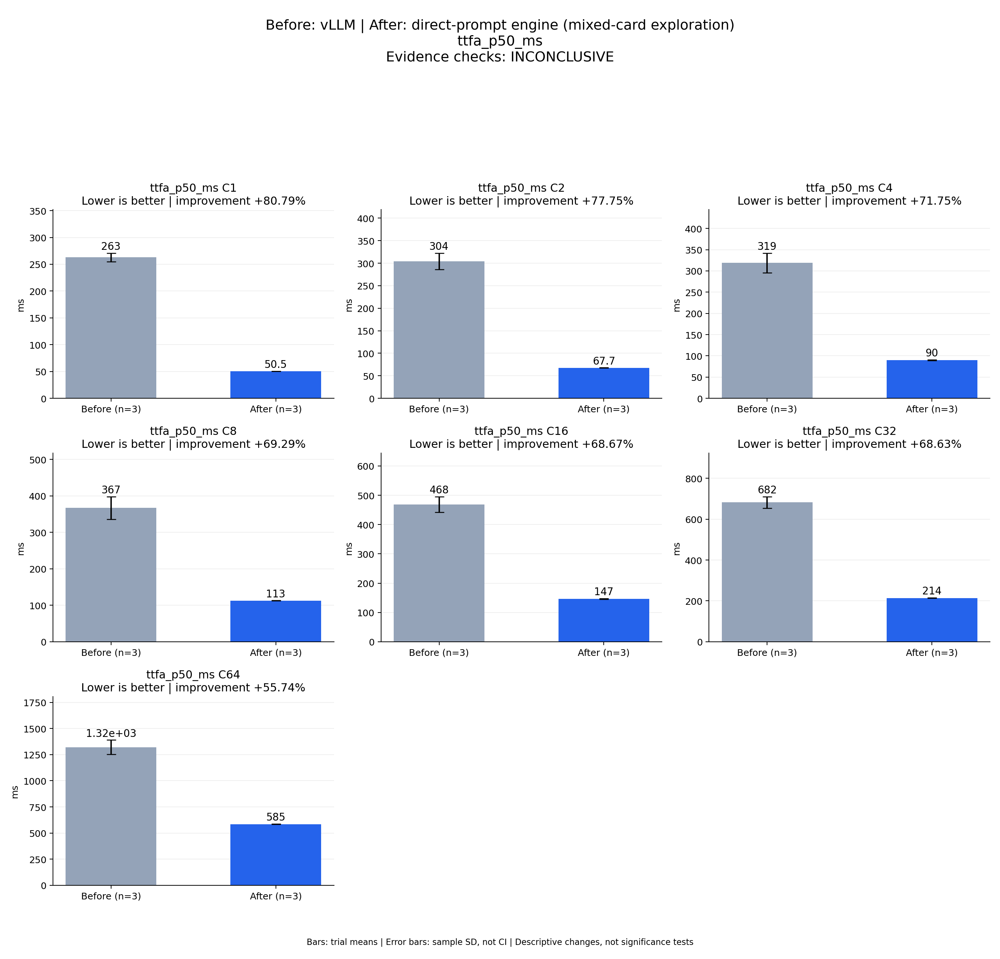

# Before: vLLM | After: direct-prompt engine (mixed-card exploration)
ttfa_p50_ms

Evidence checks: **INCONCLUSIVE**

PASS means supplied evidence checks passed; it does not establish a statistically significant gain.
Means are equally weighted trial means. SD is sample standard deviation, not a confidence interval.

| Metric / scenario | Direction | Before mean ± SD (n) | After mean ± SD (n) | Improvement | Scope |
|---|---|---:|---:|---:|---|
| ttfa_p50_ms / C1 (ms) | lower | 262.755 ± 8.01801 (n=3) | 50.4728 ± 0.284953 (n=3) | +80.79% | repeated trials |
| ttfa_p50_ms / C2 (ms) | lower | 304.096 ± 18.2207 (n=3) | 67.6536 ± 0.354522 (n=3) | +77.75% | repeated trials |
| ttfa_p50_ms / C4 (ms) | lower | 318.701 ± 23.1862 (n=3) | 90.0327 ± 0.591361 (n=3) | +71.75% | repeated trials |
| ttfa_p50_ms / C8 (ms) | lower | 366.711 ± 31.2517 (n=3) | 112.6 ± 0.486906 (n=3) | +69.29% | repeated trials |
| ttfa_p50_ms / C16 (ms) | lower | 468.44 ± 27.0466 (n=3) | 146.751 ± 0.998816 (n=3) | +68.67% | repeated trials |
| ttfa_p50_ms / C32 (ms) | lower | 682.237 ± 28.0824 (n=3) | 214.044 ± 1.37301 (n=3) | +68.63% | repeated trials |
| ttfa_p50_ms / C64 (ms) | lower | 1320.74 ± 69.0379 (n=3) | 584.561 ± 1.61895 (n=3) | +55.74% | repeated trials |



## Input and provenance

```json
{
  "title": "Before: vLLM | After: direct-prompt engine (mixed-card exploration)\nttfa_p50_ms",
  "synthetic": false,
  "context": {
    "hardware": "Ascend 910B1; candidate physical NPU 6; vLLM trials 1/2 NPU 0, trial 3 NPU 1; shared host",
    "model": "Qwen3-TTS-12Hz-1.7B-CustomVoice BF16, pinned weights",
    "workload": "128 fixed requests at each C1/2/4/8/16/32/64",
    "baseline_revision": [
      "b164fea797531c1fa10f8b87829632cad006b9fc",
      "b164fea797531c1fa10f8b87829632cad006b9fc",
      "b164fea797531c1fa10f8b87829632cad006b9fc"
    ],
    "candidate_revision": [
      "e783a64b0fb4f9ade2ffb3980b3e1f74a00c9a6a",
      "e783a64b0fb4f9ade2ffb3980b3e1f74a00c9a6a",
      "e783a64b0fb4f9ade2ffb3980b3e1f74a00c9a6a"
    ],
    "source_logs": [
      "runs/vllm-sweep-round1-full128/status.json",
      "runs/vllm-sweep-round2-full128/status.json",
      "runs/vllm-sweep-round3-full128/status.json",
      "runs/continuous-direct-prompt-full-round1/status.json",
      "runs/continuous-direct-prompt-full-round2/status.json",
      "runs/continuous-direct-prompt-full-round3/status.json"
    ]
  },
  "checks": {
    "comparable": "unknown",
    "correctness": "unknown",
    "lifecycle": "pass"
  },
  "runs": {
    "before": {
      "completed": 2688,
      "failed": 0
    },
    "after": {
      "completed": 2688,
      "failed": 0
    }
  },
  "notes": [
    "Three independent processes per arm; bars are means and error bars sample standard deviations, not confidence intervals.",
    "Mixed physical cards and shared-host conditions prevent final acceptance from this figure.",
    "Candidate independent scoring is incomplete; all candidate repeat WAVs match trial 1, recorded separately.",
    "TTFA p50/p95 bars summarize per-trial percentile statistics; they are not pooled-request percentiles.",
    "This is a vLLM comparison only; final same-card three-framework validation remains pending."
  ],
  "metrics": [
    {
      "name": "ttfa_p50_ms",
      "unit": "ms",
      "direction": "lower",
      "scenario": "C1",
      "before": [
        270.9299558773637,
        262.4301319010556,
        254.9037914723158
      ],
      "after": [
        50.201274920254946,
        50.769499968737364,
        50.44751614332199
      ]
    },
    {
      "name": "ttfa_p50_ms",
      "unit": "ms",
      "direction": "lower",
      "scenario": "C2",
      "before": [
        324.36227006837726,
        298.85789612308145,
        289.0684646554291
      ],
      "after": [
        67.25503457710147,
        67.77182267978787,
        67.93385231867433
      ]
    },
    {
      "name": "ttfa_p50_ms",
      "unit": "ms",
      "direction": "lower",
      "scenario": "C4",
      "before": [
        344.9574699625373,
        310.1064171642065,
        301.03933019563556
      ],
      "after": [
        90.61838733032346,
        89.43582698702812,
        90.04402300342917
      ]
    },
    {
      "name": "ttfa_p50_ms",
      "unit": "ms",
      "direction": "lower",
      "scenario": "C8",
      "before": [
        391.4935803040862,
        377.03682528808713,
        331.6035089083016
      ],
      "after": [
        112.22930951043963,
        113.15177893266082,
        112.42031957954168
      ]
    },
    {
      "name": "ttfa_p50_ms",
      "unit": "ms",
      "direction": "lower",
      "scenario": "C16",
      "before": [
        498.53252014145255,
        460.62856959179044,
        446.1585464887321
      ],
      "after": [
        146.53422450646758,
        145.8788374438882,
        147.8407746180892
      ]
    },
    {
      "name": "ttfa_p50_ms",
      "unit": "ms",
      "direction": "lower",
      "scenario": "C32",
      "before": [
        709.2177751474082,
        653.169259428978,
        684.3228046782315
      ],
      "after": [
        212.46400382369757,
        214.94457451626658,
        214.72434420138597
      ]
    },
    {
      "name": "ttfa_p50_ms",
      "unit": "ms",
      "direction": "lower",
      "scenario": "C64",
      "before": [
        1395.918546244502,
        1306.1149627901614,
        1260.1862191222608
      ],
      "after": [
        583.2359520718455,
        584.0809969231486,
        586.3654017448425
      ]
    }
  ]
}
```
