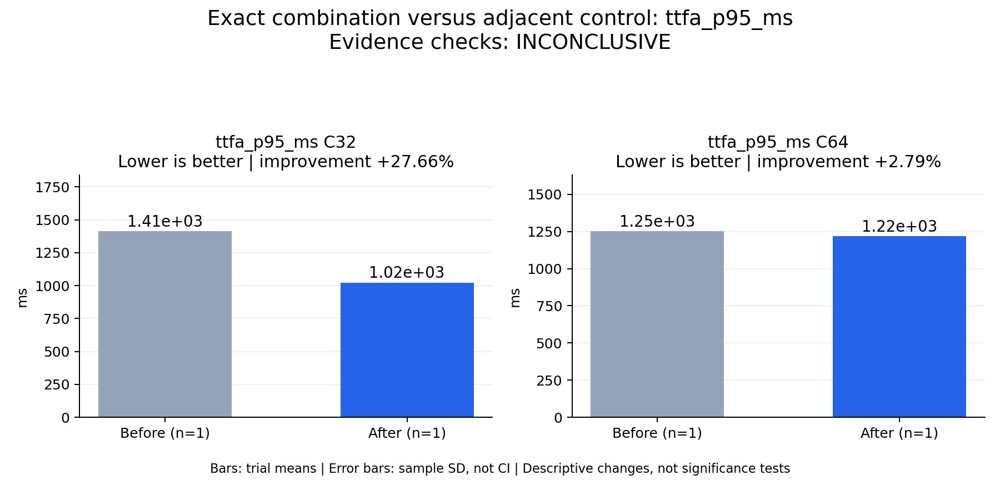

# Exact combination versus adjacent control: ttfa_p95_ms

Evidence checks: **INCONCLUSIVE**

PASS means supplied evidence checks passed; it does not establish a statistically significant gain.
Means are equally weighted trial means. SD is sample standard deviation, not a confidence interval.

| Metric / scenario | Direction | Before mean ± SD (n) | After mean ± SD (n) | Improvement | Scope |
|---|---|---:|---:|---:|---|
| ttfa_p95_ms / C32 (ms) | lower | 1414.1 ± N/A (n=1) | 1022.92 ± N/A (n=1) | +27.66% | single trial |
| ttfa_p95_ms / C64 (ms) | lower | 1252.76 ± N/A (n=1) | 1217.77 ± N/A (n=1) | +2.79% | single trial |



## Input and provenance

```json
{
  "title": "Exact combination versus adjacent control: ttfa_p95_ms",
  "synthetic": false,
  "context": {
    "hardware": "Ascend 910B1 physical NPU 6, shared host",
    "model": "Qwen3-TTS-12Hz-1.7B-CustomVoice BF16",
    "workload": "Frozen 128-record corpus per concurrency",
    "baseline_revision": "f8c3d0e1a871b6af6658dd00e50665a09f310200",
    "candidate_revision": "b3498718dc31a49993cce4e02300a2a87c75aeb7",
    "source_logs": [
      "runs/continuous-valid-length-control-c32-c64-retry/status.json",
      "runs/continuous-exact-combined-c32-c64/status.json"
    ],
    "wave_identity": {
      "continuous-valid-length-control-c32-c64-retry": {
        "32": 128,
        "64": 128
      },
      "continuous-exact-combined-c32-c64": {
        "32": 128,
        "64": 128
      }
    }
  },
  "checks": {
    "comparable": "unknown",
    "correctness": "pass",
    "lifecycle": "pass"
  },
  "runs": {
    "before": {
      "completed": 256,
      "failed": 0
    },
    "after": {
      "completed": 256,
      "failed": 0
    }
  },
  "notes": [
    "One independent run per arm; no error bars or statistical significance claim.",
    "Same physical NPU, shared-host interference and temporal variation not excluded.",
    "Quality transferred only by complete WAV byte identity to previously scored full candidate; not independent scoring reruns.",
    "Control then combination. This is a direct measured combination, not multiplied isolated gains.",
    "Not a comparison to both baseline frameworks or final three-repeat 2x acceptance."
  ],
  "metrics": [
    {
      "name": "ttfa_p95_ms",
      "unit": "ms",
      "direction": "lower",
      "scenario": "C32",
      "before": [
        1414.0980126801878
      ],
      "after": [
        1022.9151702485977
      ]
    },
    {
      "name": "ttfa_p95_ms",
      "unit": "ms",
      "direction": "lower",
      "scenario": "C64",
      "before": [
        1252.7570909354836
      ],
      "after": [
        1217.774145398289
      ]
    }
  ]
}
```
