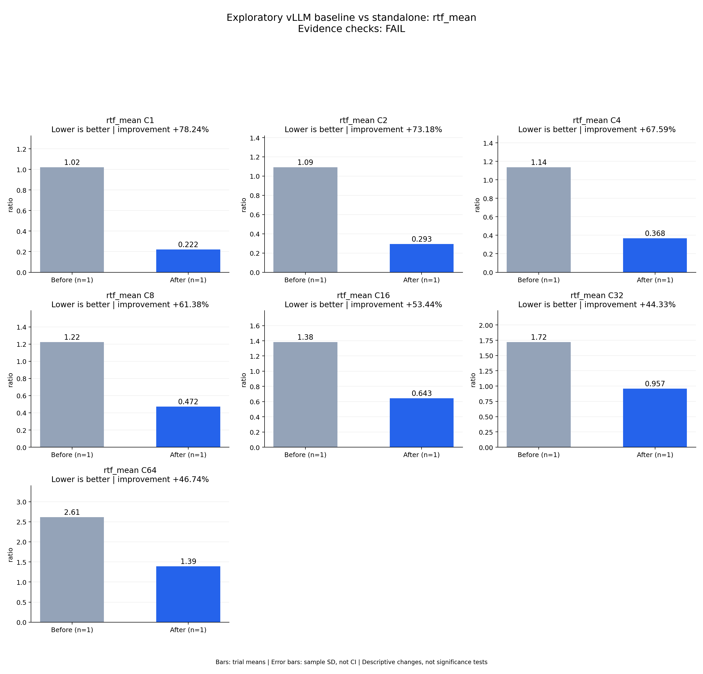

# Exploratory vLLM baseline vs standalone: rtf_mean

Evidence checks: **FAIL**

PASS means supplied evidence checks passed; it does not establish a statistically significant gain.
Means are equally weighted trial means. SD is sample standard deviation, not a confidence interval.

| Metric / scenario | Direction | Before mean ± SD (n) | After mean ± SD (n) | Improvement | Scope |
|---|---|---:|---:|---:|---|
| rtf_mean / C1 (ratio) | lower | 1.02104 ± N/A (n=1) | 0.222164 ± N/A (n=1) | +78.24% | single trial |
| rtf_mean / C2 (ratio) | lower | 1.09211 ± N/A (n=1) | 0.292956 ± N/A (n=1) | +73.18% | single trial |
| rtf_mean / C4 (ratio) | lower | 1.13613 ± N/A (n=1) | 0.368192 ± N/A (n=1) | +67.59% | single trial |
| rtf_mean / C8 (ratio) | lower | 1.22169 ± N/A (n=1) | 0.471861 ± N/A (n=1) | +61.38% | single trial |
| rtf_mean / C16 (ratio) | lower | 1.38156 ± N/A (n=1) | 0.643186 ± N/A (n=1) | +53.44% | single trial |
| rtf_mean / C32 (ratio) | lower | 1.7185 ± N/A (n=1) | 0.956772 ± N/A (n=1) | +44.33% | single trial |
| rtf_mean / C64 (ratio) | lower | 2.61484 ± N/A (n=1) | 1.39269 ± N/A (n=1) | +46.74% | single trial |



## Input and provenance

```json
{
  "title": "Exploratory vLLM baseline vs standalone: rtf_mean",
  "synthetic": false,
  "context": {
    "hardware": "One Ascend 910B1, physical device 0, shared host",
    "model": "Qwen3-TTS-12Hz-1.7B-CustomVoice BF16",
    "workload_sha256": "5007716c83b29d0247b2c6291b9704c652e01a94362c19e90ea3cb34987060c7",
    "baseline_revision": "b164fea797531c1fa10f8b87829632cad006b9fc",
    "candidate_revision": "3ef961a70b59ff653f1568d852121ca07370ccf6",
    "source_logs": [
      "runs/vllm-sweep-round1-full128/status.json",
      "runs/sglang-sweep-round1-full128/status.json",
      "runs/continuous-native-rope-sampling-full/status.json"
    ],
    "timing_scope": "Warm service, client dispatch through terminal PCM event; TTFA first nonempty PCM"
  },
  "checks": {
    "comparable": "unknown",
    "correctness": "fail",
    "lifecycle": "pass"
  },
  "runs": {
    "before": {
      "completed": 896,
      "failed": 0
    },
    "after": {
      "completed": 896,
      "failed": 0
    }
  },
  "notes": [
    "Single independent run per arm; no repeat error bars or statistical significance claim.",
    "vLLM has higher measured throughput than SGLang at every concurrency; all four metrics compare against that same selected framework.",
    "C16 candidate Chinese CER 0.03807947 exceeds frozen 0.03566225 limit; all other full ASR/speaker cohort gates pass.",
    "Both arms exited 0. Shared-host temporal variability is not controlled; full three-repeat acceptance remains pending.",
    "Do not combine gains from other configurations with this measured candidate."
  ],
  "metrics": [
    {
      "name": "rtf_mean",
      "unit": "ratio",
      "direction": "lower",
      "scenario": "C1",
      "before": [
        1.021043179537028
      ],
      "after": [
        0.22216432673238115
      ]
    },
    {
      "name": "rtf_mean",
      "unit": "ratio",
      "direction": "lower",
      "scenario": "C2",
      "before": [
        1.0921106427737464
      ],
      "after": [
        0.2929564024548201
      ]
    },
    {
      "name": "rtf_mean",
      "unit": "ratio",
      "direction": "lower",
      "scenario": "C4",
      "before": [
        1.1361252515339015
      ],
      "after": [
        0.3681919052185044
      ]
    },
    {
      "name": "rtf_mean",
      "unit": "ratio",
      "direction": "lower",
      "scenario": "C8",
      "before": [
        1.2216941816145934
      ],
      "after": [
        0.471861415767732
      ]
    },
    {
      "name": "rtf_mean",
      "unit": "ratio",
      "direction": "lower",
      "scenario": "C16",
      "before": [
        1.3815607495303417
      ],
      "after": [
        0.6431861511661263
      ]
    },
    {
      "name": "rtf_mean",
      "unit": "ratio",
      "direction": "lower",
      "scenario": "C32",
      "before": [
        1.7184953824042835
      ],
      "after": [
        0.9567715245619896
      ]
    },
    {
      "name": "rtf_mean",
      "unit": "ratio",
      "direction": "lower",
      "scenario": "C64",
      "before": [
        2.6148350119770956
      ],
      "after": [
        1.3926872365463625
      ]
    }
  ]
}
```
