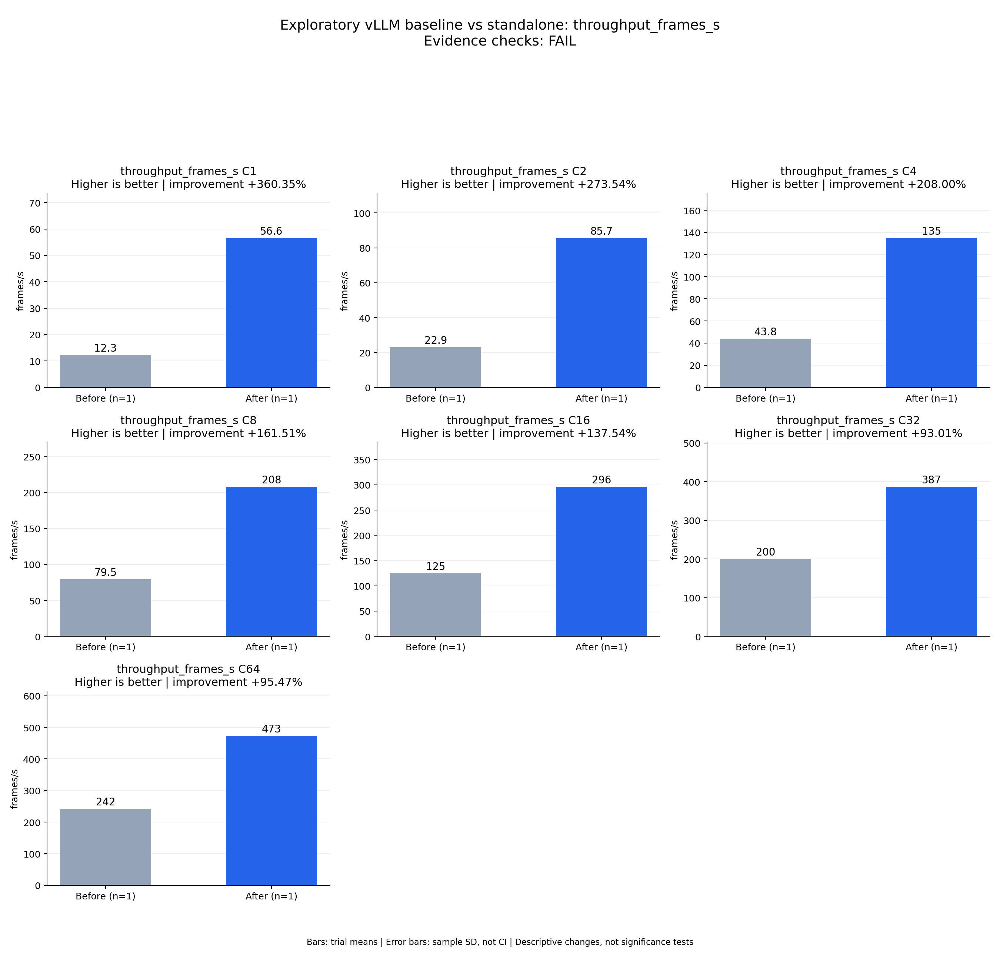

# Exploratory vLLM baseline vs standalone: throughput_frames_s

Evidence checks: **FAIL**

PASS means supplied evidence checks passed; it does not establish a statistically significant gain.
Means are equally weighted trial means. SD is sample standard deviation, not a confidence interval.

| Metric / scenario | Direction | Before mean ± SD (n) | After mean ± SD (n) | Improvement | Scope |
|---|---|---:|---:|---:|---|
| throughput_frames_s / C1 (frames/s) | higher | 12.2968 ± N/A (n=1) | 56.6082 ± N/A (n=1) | +360.35% | single trial |
| throughput_frames_s / C2 (frames/s) | higher | 22.9432 ± N/A (n=1) | 85.7018 ± N/A (n=1) | +273.54% | single trial |
| throughput_frames_s / C4 (frames/s) | higher | 43.8313 ± N/A (n=1) | 135 ± N/A (n=1) | +208.00% | single trial |
| throughput_frames_s / C8 (frames/s) | higher | 79.4908 ± N/A (n=1) | 207.879 ± N/A (n=1) | +161.51% | single trial |
| throughput_frames_s / C16 (frames/s) | higher | 124.596 ± N/A (n=1) | 295.962 ± N/A (n=1) | +137.54% | single trial |
| throughput_frames_s / C32 (frames/s) | higher | 200.265 ± N/A (n=1) | 386.54 ± N/A (n=1) | +93.01% | single trial |
| throughput_frames_s / C64 (frames/s) | higher | 242.077 ± N/A (n=1) | 473.183 ± N/A (n=1) | +95.47% | single trial |



## Input and provenance

```json
{
  "title": "Exploratory vLLM baseline vs standalone: throughput_frames_s",
  "synthetic": false,
  "context": {
    "hardware": "One Ascend 910B1, physical device 0, shared host",
    "model": "Qwen3-TTS-12Hz-1.7B-CustomVoice BF16",
    "workload_sha256": "5007716c83b29d0247b2c6291b9704c652e01a94362c19e90ea3cb34987060c7",
    "baseline_revision": "b164fea797531c1fa10f8b87829632cad006b9fc",
    "candidate_revision": "3ef961a70b59ff653f1568d852121ca07370ccf6",
    "source_logs": [
      "runs/vllm-sweep-round1-full128/status.json",
      "runs/sglang-sweep-round1-full128/status.json",
      "runs/continuous-native-rope-sampling-full/status.json"
    ],
    "timing_scope": "Warm service, client dispatch through terminal PCM event; TTFA first nonempty PCM"
  },
  "checks": {
    "comparable": "unknown",
    "correctness": "fail",
    "lifecycle": "pass"
  },
  "runs": {
    "before": {
      "completed": 896,
      "failed": 0
    },
    "after": {
      "completed": 896,
      "failed": 0
    }
  },
  "notes": [
    "Single independent run per arm; no repeat error bars or statistical significance claim.",
    "vLLM has higher measured throughput than SGLang at every concurrency; all four metrics compare against that same selected framework.",
    "C16 candidate Chinese CER 0.03807947 exceeds frozen 0.03566225 limit; all other full ASR/speaker cohort gates pass.",
    "Both arms exited 0. Shared-host temporal variability is not controlled; full three-repeat acceptance remains pending.",
    "Do not combine gains from other configurations with this measured candidate."
  ],
  "metrics": [
    {
      "name": "throughput_frames_s",
      "unit": "frames/s",
      "direction": "higher",
      "scenario": "C1",
      "before": [
        12.296847685489093
      ],
      "after": [
        56.60815132745007
      ]
    },
    {
      "name": "throughput_frames_s",
      "unit": "frames/s",
      "direction": "higher",
      "scenario": "C2",
      "before": [
        22.943153962655607
      ],
      "after": [
        85.70181413227657
      ]
    },
    {
      "name": "throughput_frames_s",
      "unit": "frames/s",
      "direction": "higher",
      "scenario": "C4",
      "before": [
        43.83126223034298
      ],
      "after": [
        135.0004499405149
      ]
    },
    {
      "name": "throughput_frames_s",
      "unit": "frames/s",
      "direction": "higher",
      "scenario": "C8",
      "before": [
        79.49077891672454
      ],
      "after": [
        207.8787024690451
      ]
    },
    {
      "name": "throughput_frames_s",
      "unit": "frames/s",
      "direction": "higher",
      "scenario": "C16",
      "before": [
        124.59641583494476
      ],
      "after": [
        295.96242872166073
      ]
    },
    {
      "name": "throughput_frames_s",
      "unit": "frames/s",
      "direction": "higher",
      "scenario": "C32",
      "before": [
        200.26527505533156
      ],
      "after": [
        386.54035240535575
      ]
    },
    {
      "name": "throughput_frames_s",
      "unit": "frames/s",
      "direction": "higher",
      "scenario": "C64",
      "before": [
        242.0768702666381
      ],
      "after": [
        473.1832376578836
      ]
    }
  ]
}
```
