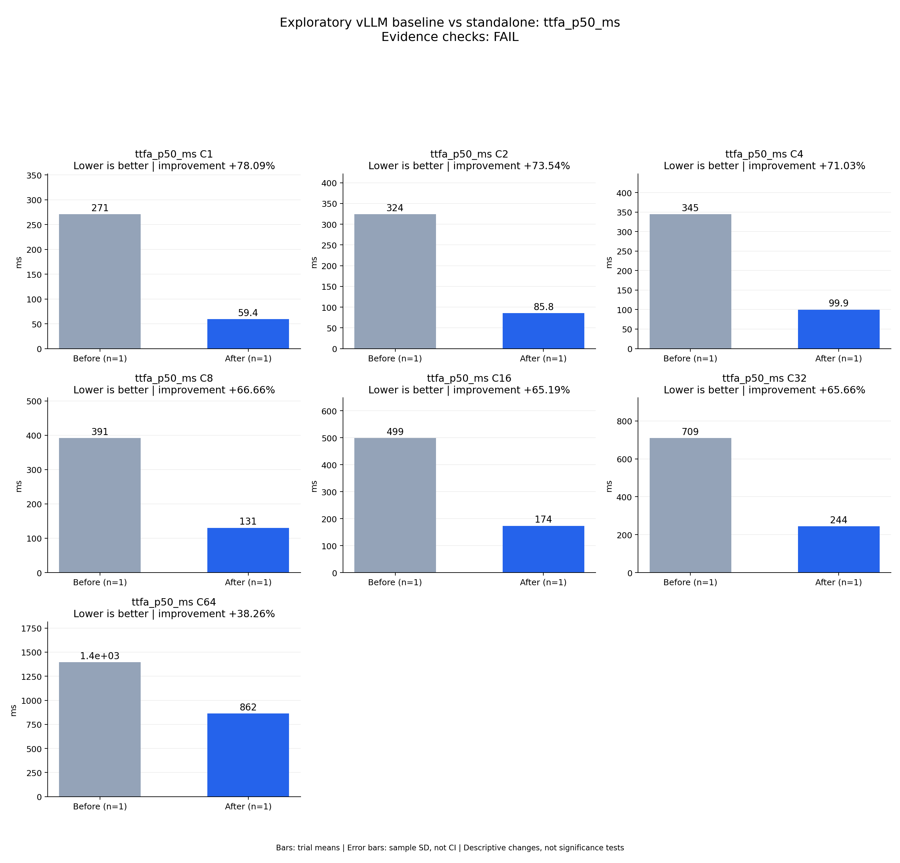

# Exploratory vLLM baseline vs standalone: ttfa_p50_ms

Evidence checks: **FAIL**

PASS means supplied evidence checks passed; it does not establish a statistically significant gain.
Means are equally weighted trial means. SD is sample standard deviation, not a confidence interval.

| Metric / scenario | Direction | Before mean ± SD (n) | After mean ± SD (n) | Improvement | Scope |
|---|---|---:|---:|---:|---|
| ttfa_p50_ms / C1 (ms) | lower | 270.93 ± N/A (n=1) | 59.3654 ± N/A (n=1) | +78.09% | single trial |
| ttfa_p50_ms / C2 (ms) | lower | 324.362 ± N/A (n=1) | 85.8419 ± N/A (n=1) | +73.54% | single trial |
| ttfa_p50_ms / C4 (ms) | lower | 344.957 ± N/A (n=1) | 99.9362 ± N/A (n=1) | +71.03% | single trial |
| ttfa_p50_ms / C8 (ms) | lower | 391.494 ± N/A (n=1) | 130.526 ± N/A (n=1) | +66.66% | single trial |
| ttfa_p50_ms / C16 (ms) | lower | 498.533 ± N/A (n=1) | 173.535 ± N/A (n=1) | +65.19% | single trial |
| ttfa_p50_ms / C32 (ms) | lower | 709.218 ± N/A (n=1) | 243.571 ± N/A (n=1) | +65.66% | single trial |
| ttfa_p50_ms / C64 (ms) | lower | 1395.92 ± N/A (n=1) | 861.812 ± N/A (n=1) | +38.26% | single trial |



## Input and provenance

```json
{
  "title": "Exploratory vLLM baseline vs standalone: ttfa_p50_ms",
  "synthetic": false,
  "context": {
    "hardware": "One Ascend 910B1, physical device 0, shared host",
    "model": "Qwen3-TTS-12Hz-1.7B-CustomVoice BF16",
    "workload_sha256": "5007716c83b29d0247b2c6291b9704c652e01a94362c19e90ea3cb34987060c7",
    "baseline_revision": "b164fea797531c1fa10f8b87829632cad006b9fc",
    "candidate_revision": "3ef961a70b59ff653f1568d852121ca07370ccf6",
    "source_logs": [
      "runs/vllm-sweep-round1-full128/status.json",
      "runs/sglang-sweep-round1-full128/status.json",
      "runs/continuous-native-rope-sampling-full/status.json"
    ],
    "timing_scope": "Warm service, client dispatch through terminal PCM event; TTFA first nonempty PCM"
  },
  "checks": {
    "comparable": "unknown",
    "correctness": "fail",
    "lifecycle": "pass"
  },
  "runs": {
    "before": {
      "completed": 896,
      "failed": 0
    },
    "after": {
      "completed": 896,
      "failed": 0
    }
  },
  "notes": [
    "Single independent run per arm; no repeat error bars or statistical significance claim.",
    "vLLM has higher measured throughput than SGLang at every concurrency; all four metrics compare against that same selected framework.",
    "C16 candidate Chinese CER 0.03807947 exceeds frozen 0.03566225 limit; all other full ASR/speaker cohort gates pass.",
    "Both arms exited 0. Shared-host temporal variability is not controlled; full three-repeat acceptance remains pending.",
    "Do not combine gains from other configurations with this measured candidate."
  ],
  "metrics": [
    {
      "name": "ttfa_p50_ms",
      "unit": "ms",
      "direction": "lower",
      "scenario": "C1",
      "before": [
        270.9299558773637
      ],
      "after": [
        59.365371242165565
      ]
    },
    {
      "name": "ttfa_p50_ms",
      "unit": "ms",
      "direction": "lower",
      "scenario": "C2",
      "before": [
        324.36227006837726
      ],
      "after": [
        85.84185596555471
      ]
    },
    {
      "name": "ttfa_p50_ms",
      "unit": "ms",
      "direction": "lower",
      "scenario": "C4",
      "before": [
        344.9574699625373
      ],
      "after": [
        99.9362450093031
      ]
    },
    {
      "name": "ttfa_p50_ms",
      "unit": "ms",
      "direction": "lower",
      "scenario": "C8",
      "before": [
        391.4935803040862
      ],
      "after": [
        130.52620133385062
      ]
    },
    {
      "name": "ttfa_p50_ms",
      "unit": "ms",
      "direction": "lower",
      "scenario": "C16",
      "before": [
        498.53252014145255
      ],
      "after": [
        173.53461869060993
      ]
    },
    {
      "name": "ttfa_p50_ms",
      "unit": "ms",
      "direction": "lower",
      "scenario": "C32",
      "before": [
        709.2177751474082
      ],
      "after": [
        243.5705056414008
      ]
    },
    {
      "name": "ttfa_p50_ms",
      "unit": "ms",
      "direction": "lower",
      "scenario": "C64",
      "before": [
        1395.918546244502
      ],
      "after": [
        861.8122604675591
      ]
    }
  ]
}
```
