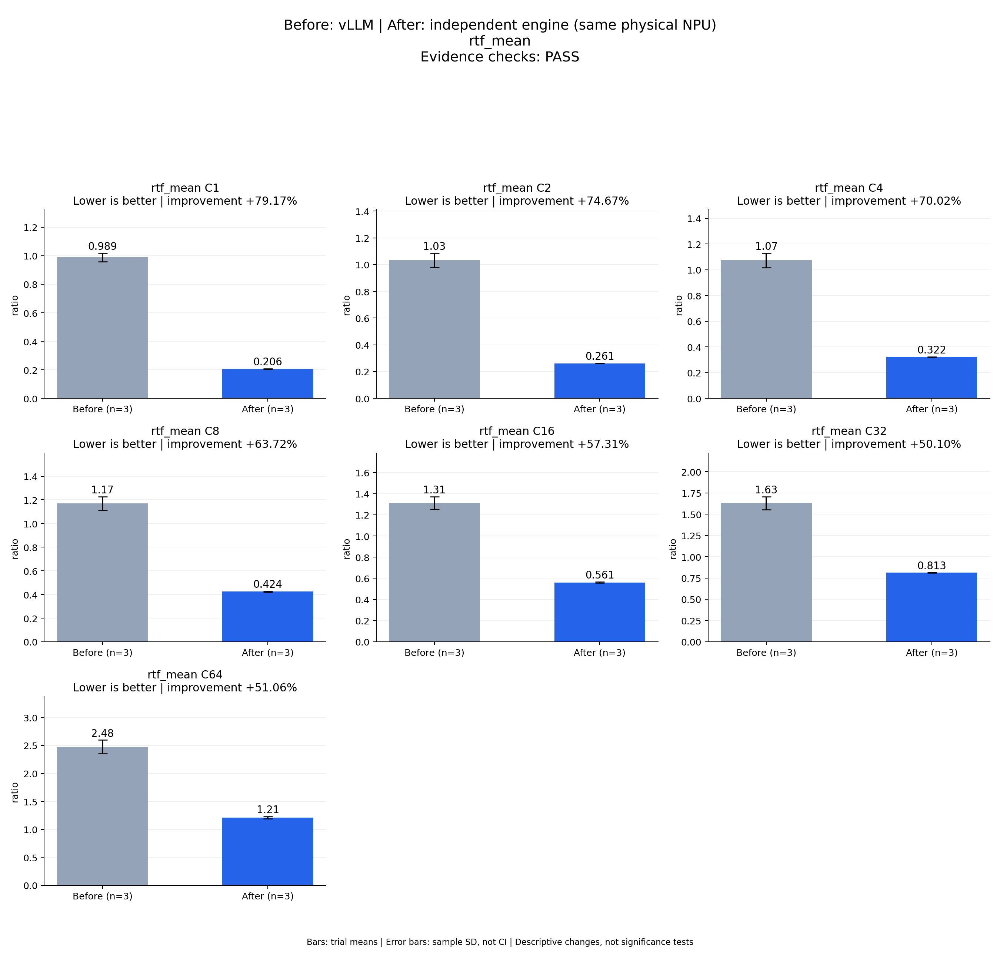

# Before: vLLM | After: independent engine (same physical NPU)
rtf_mean

Evidence checks: **PASS**

PASS means supplied evidence checks passed; it does not establish a statistically significant gain.
Means are equally weighted trial means. SD is sample standard deviation, not a confidence interval.

| Metric / scenario | Direction | Before mean ± SD (n) | After mean ± SD (n) | Improvement | Scope |
|---|---|---:|---:|---:|---|
| rtf_mean / C1 (ratio) | lower | 0.988509 ± 0.0298747 (n=3) | 0.205886 ± 0.00182011 (n=3) | +79.17% | repeated trials |
| rtf_mean / C2 (ratio) | lower | 1.03226 ± 0.0533376 (n=3) | 0.26144 ± 0.00163324 (n=3) | +74.67% | repeated trials |
| rtf_mean / C4 (ratio) | lower | 1.0728 ± 0.055899 (n=3) | 0.321619 ± 0.00110654 (n=3) | +70.02% | repeated trials |
| rtf_mean / C8 (ratio) | lower | 1.16863 ± 0.0588454 (n=3) | 0.42398 ± 0.00351441 (n=3) | +63.72% | repeated trials |
| rtf_mean / C16 (ratio) | lower | 1.31309 ± 0.0593138 (n=3) | 0.560526 ± 0.00603704 (n=3) | +57.31% | repeated trials |
| rtf_mean / C32 (ratio) | lower | 1.63016 ± 0.0765563 (n=3) | 0.813446 ± 0.00251718 (n=3) | +50.10% | repeated trials |
| rtf_mean / C64 (ratio) | lower | 2.47655 ± 0.119897 (n=3) | 1.21209 ± 0.0195452 (n=3) | +51.06% | repeated trials |



## Input and provenance

```json
{
  "title": "Before: vLLM | After: independent engine (same physical NPU)\nrtf_mean",
  "synthetic": false,
  "context": {
    "hardware": "Ascend 910B1 physical NPU 0, one device per arm, shared host",
    "model": "Qwen3-TTS-12Hz-1.7B-CustomVoice BF16, pinned weights",
    "workload": "128 fixed requests at each C1/2/4/8/16/32/64",
    "baseline_revision": [
      "b164fea797531c1fa10f8b87829632cad006b9fc",
      "b164fea797531c1fa10f8b87829632cad006b9fc",
      "b164fea797531c1fa10f8b87829632cad006b9fc"
    ],
    "candidate_revision": [
      "e783a64b0fb4f9ade2ffb3980b3e1f74a00c9a6a",
      "e783a64b0fb4f9ade2ffb3980b3e1f74a00c9a6a",
      "e783a64b0fb4f9ade2ffb3980b3e1f74a00c9a6a"
    ],
    "source_logs": [
      "runs/vllm-sweep-round1-full128/status.json",
      "runs/vllm-sweep-round2-full128/status.json",
      "runs/vllm-sweep-round3-card0-full128/status.json",
      "runs/continuous-direct-prompt-card0-round1/status.json",
      "runs/continuous-direct-prompt-card0-round2/status.json",
      "runs/continuous-direct-prompt-card0-round3/status.json"
    ]
  },
  "checks": {
    "comparable": "pass",
    "correctness": "pass",
    "lifecycle": "pass"
  },
  "runs": {
    "before": {
      "completed": 2688,
      "failed": 0
    },
    "after": {
      "completed": 2688,
      "failed": 0
    }
  },
  "notes": [
    "Three independent server processes per arm; bars are means and error bars sample standard deviations, not confidence intervals.",
    "All arms used physical NPU 0; host activity was shared and trials were sequential, not randomized.",
    "All 2,688 candidate waveforms independently scored; all 63 cohorts and 21 candidate contract comparisons passed. See final acceptance for scope and qualifications.",
    "TTFA p50/p95 bars summarize per-trial percentiles, not pooled-request percentiles.",
    "vLLM is the faster measured baseline at every concurrency; all SGLang observations remain in the machine-readable comparison.",
    "Round-1 vLLM physical device is recorded in the contemporaneous campaign report; its older runner lacks the environment field."
  ],
  "metrics": [
    {
      "name": "rtf_mean",
      "unit": "ratio",
      "direction": "lower",
      "scenario": "C1",
      "before": [
        1.021043179537028,
        0.982175721115547,
        0.9623095195383553
      ],
      "after": [
        0.2038573162517171,
        0.20737589161863382,
        0.20642477178972177
      ]
    },
    {
      "name": "rtf_mean",
      "unit": "ratio",
      "direction": "lower",
      "scenario": "C2",
      "before": [
        1.0921106427737464,
        1.0149255174912346,
        0.9897485879036045
      ],
      "after": [
        0.25964807965911046,
        0.26284548437526284,
        0.2618254754374273
      ]
    },
    {
      "name": "rtf_mean",
      "unit": "ratio",
      "direction": "lower",
      "scenario": "C4",
      "before": [
        1.1361252515339015,
        1.0519599005503668,
        1.030314649660105
      ],
      "after": [
        0.32042284619447514,
        0.32182772795295417,
        0.32260618095671334
      ]
    },
    {
      "name": "rtf_mean",
      "unit": "ratio",
      "direction": "lower",
      "scenario": "C8",
      "before": [
        1.2216941816145934,
        1.1788510196547728,
        1.1053427165781742
      ],
      "after": [
        0.4236140614507102,
        0.42066356436496044,
        0.4276636822266349
      ]
    },
    {
      "name": "rtf_mean",
      "unit": "ratio",
      "direction": "lower",
      "scenario": "C16",
      "before": [
        1.3815607495303417,
        1.2776324467121596,
        1.2800632847815152
      ],
      "after": [
        0.5546739061574572,
        0.56017036944198,
        0.5667323121032652
      ]
    },
    {
      "name": "rtf_mean",
      "unit": "ratio",
      "direction": "lower",
      "scenario": "C32",
      "before": [
        1.7184953824042835,
        1.5888183318249476,
        1.5831550793945757
      ],
      "after": [
        0.8105437490946605,
        0.8147629363800615,
        0.8150318849434969
      ]
    },
    {
      "name": "rtf_mean",
      "unit": "ratio",
      "direction": "lower",
      "scenario": "C64",
      "before": [
        2.6148350119770956,
        2.4016064005608397,
        2.413214096604622
      ],
      "after": [
        1.1895322156467878,
        1.2240149637968836,
        1.2227187673903868
      ]
    }
  ]
}
```
