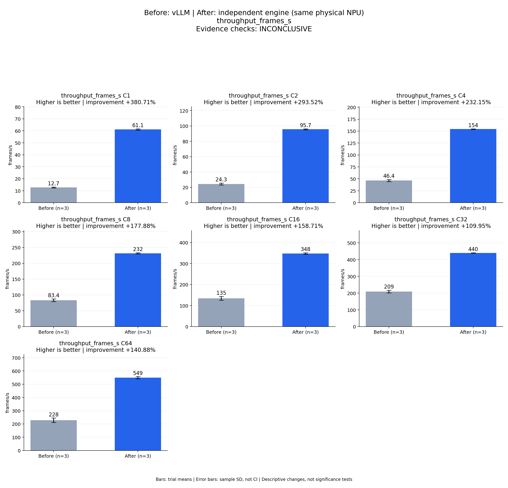

# Before: vLLM | After: independent engine (same physical NPU)
throughput_frames_s

Evidence checks: **INCONCLUSIVE**

PASS means supplied evidence checks passed; it does not establish a statistically significant gain.
Means are equally weighted trial means. SD is sample standard deviation, not a confidence interval.

| Metric / scenario | Direction | Before mean ± SD (n) | After mean ± SD (n) | Improvement | Scope |
|---|---|---:|---:|---:|---|
| throughput_frames_s / C1 (frames/s) | higher | 12.715 ± 0.385778 (n=3) | 61.1224 ± 0.538264 (n=3) | +380.71% | repeated trials |
| throughput_frames_s / C2 (frames/s) | higher | 24.3242 ± 1.23363 (n=3) | 95.7203 ± 0.607821 (n=3) | +293.52% | repeated trials |
| throughput_frames_s / C4 (frames/s) | higher | 46.4336 ± 2.31792 (n=3) | 154.229 ± 0.548931 (n=3) | +232.15% | repeated trials |
| throughput_frames_s / C8 (frames/s) | higher | 83.3629 ± 4.31967 (n=3) | 231.653 ± 1.87357 (n=3) | +177.88% | repeated trials |
| throughput_frames_s / C16 (frames/s) | higher | 134.521 ± 8.81184 (n=3) | 348.024 ± 3.69225 (n=3) | +158.71% | repeated trials |
| throughput_frames_s / C32 (frames/s) | higher | 209.449 ± 7.95698 (n=3) | 439.731 ± 1.50031 (n=3) | +109.95% | repeated trials |
| throughput_frames_s / C64 (frames/s) | higher | 228.074 ± 16.731 (n=3) | 549.388 ± 8.00636 (n=3) | +140.88% | repeated trials |



## Input and provenance

```json
{
  "title": "Before: vLLM | After: independent engine (same physical NPU)\nthroughput_frames_s",
  "synthetic": false,
  "context": {
    "hardware": "Ascend 910B1 physical NPU 0, one device per arm, shared host",
    "model": "Qwen3-TTS-12Hz-1.7B-CustomVoice BF16, pinned weights",
    "workload": "128 fixed requests at each C1/2/4/8/16/32/64",
    "baseline_revision": [
      "b164fea797531c1fa10f8b87829632cad006b9fc",
      "b164fea797531c1fa10f8b87829632cad006b9fc",
      "b164fea797531c1fa10f8b87829632cad006b9fc"
    ],
    "candidate_revision": [
      "e783a64b0fb4f9ade2ffb3980b3e1f74a00c9a6a",
      "e783a64b0fb4f9ade2ffb3980b3e1f74a00c9a6a",
      "e783a64b0fb4f9ade2ffb3980b3e1f74a00c9a6a"
    ],
    "source_logs": [
      "runs/vllm-sweep-round1-full128/status.json",
      "runs/vllm-sweep-round2-full128/status.json",
      "runs/vllm-sweep-round3-card0-full128/status.json",
      "runs/continuous-direct-prompt-card0-round1/status.json",
      "runs/continuous-direct-prompt-card0-round2/status.json",
      "runs/continuous-direct-prompt-card0-round3/status.json"
    ]
  },
  "checks": {
    "comparable": "unknown",
    "correctness": "unknown",
    "lifecycle": "pass"
  },
  "runs": {
    "before": {
      "completed": 2688,
      "failed": 0
    },
    "after": {
      "completed": 2688,
      "failed": 0
    }
  },
  "notes": [
    "Three independent server processes per arm; bars are means and error bars sample standard deviations, not confidence intervals.",
    "All arms used physical NPU 0; host activity was shared and trials were sequential, not randomized.",
    "Full independent candidate scoring is still running; this figure is not final acceptance.",
    "TTFA p50/p95 bars summarize per-trial percentiles, not pooled-request percentiles.",
    "vLLM is the faster measured baseline at every concurrency; all SGLang observations remain in the machine-readable comparison.",
    "Round-1 vLLM physical device is recorded in the contemporaneous campaign report; its older runner lacks the environment field."
  ],
  "metrics": [
    {
      "name": "throughput_frames_s",
      "unit": "frames/s",
      "direction": "higher",
      "scenario": "C1",
      "before": [
        12.296847685489093,
        12.791066544709883,
        13.057069443918317
      ],
      "after": [
        61.7224955595445,
        60.682120504042686,
        60.96272370181913
      ]
    },
    {
      "name": "throughput_frames_s",
      "unit": "frames/s",
      "direction": "higher",
      "scenario": "C2",
      "before": [
        22.943153962655607,
        24.712437230161637,
        25.31700304027436
      ],
      "after": [
        96.38415045143954,
        95.19104950434105,
        95.58580404470027
      ]
    },
    {
      "name": "throughput_frames_s",
      "unit": "frames/s",
      "direction": "higher",
      "scenario": "C4",
      "before": [
        43.83126223034298,
        47.19281370410862,
        48.276666811796055
      ],
      "after": [
        154.82226125278515,
        154.1263345280452,
        153.73894834558527
      ]
    },
    {
      "name": "throughput_frames_s",
      "unit": "frames/s",
      "direction": "higher",
      "scenario": "C8",
      "before": [
        79.49077891672454,
        82.57597590962091,
        88.02191876997009
      ],
      "after": [
        231.8386505061736,
        233.42628233975677,
        229.6930076905481
      ]
    },
    {
      "name": "throughput_frames_s",
      "unit": "frames/s",
      "direction": "higher",
      "scenario": "C16",
      "before": [
        124.59641583494476,
        137.54177906611915,
        141.42567172815862
      ],
      "after": [
        351.5065964058386,
        348.41179923380776,
        344.15275873480266
      ]
    },
    {
      "name": "throughput_frames_s",
      "unit": "frames/s",
      "direction": "higher",
      "scenario": "C32",
      "before": [
        200.26527505533156,
        214.29404211656257,
        213.78626953431618
      ],
      "after": [
        441.4624149904621,
        438.92545921476443,
        438.80626278685594
      ]
    },
    {
      "name": "throughput_frames_s",
      "unit": "frames/s",
      "direction": "higher",
      "scenario": "C64",
      "before": [
        242.0768702666381,
        232.5999250066449,
        209.5460144105348
      ],
      "after": [
        558.6184803372047,
        544.321436475226,
        545.2248569104372
      ]
    }
  ]
}
```
