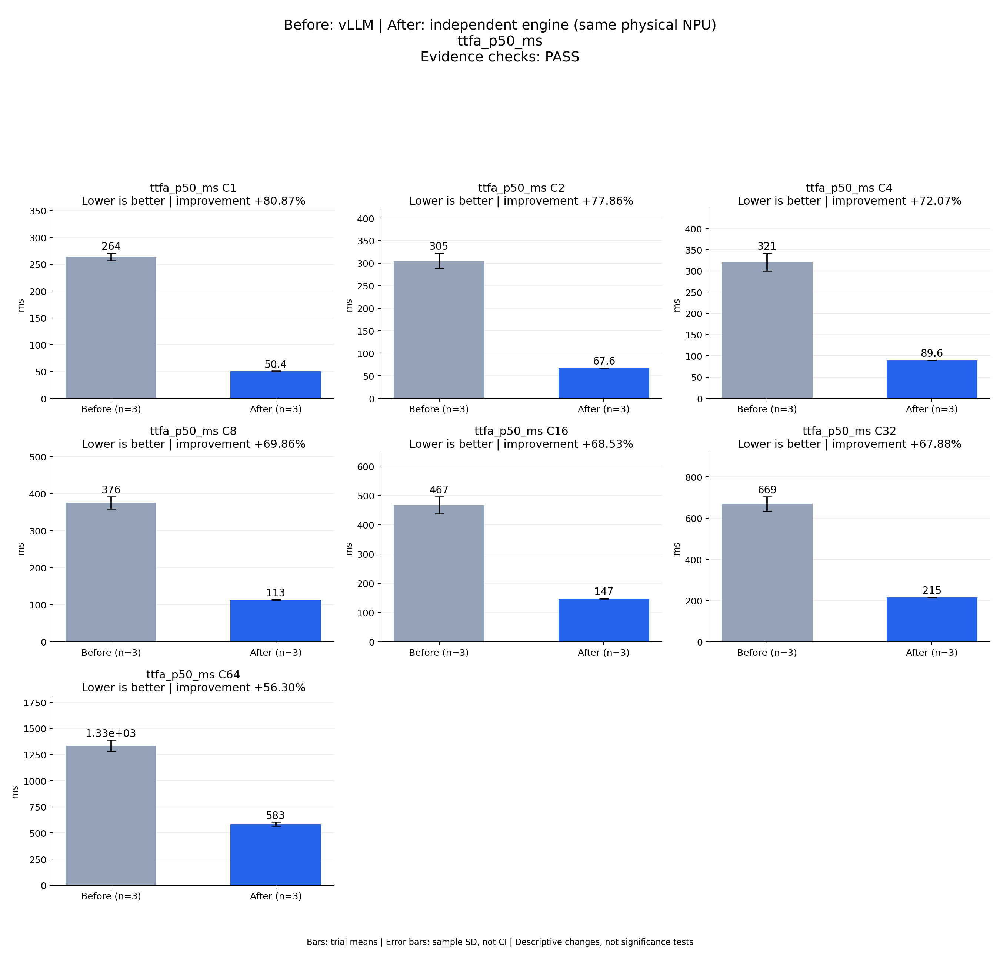

# Before: vLLM | After: independent engine (same physical NPU)
ttfa_p50_ms

Evidence checks: **PASS**

PASS means supplied evidence checks passed; it does not establish a statistically significant gain.
Means are equally weighted trial means. SD is sample standard deviation, not a confidence interval.

| Metric / scenario | Direction | Before mean ± SD (n) | After mean ± SD (n) | Improvement | Scope |
|---|---|---:|---:|---:|---|
| ttfa_p50_ms / C1 (ms) | lower | 263.515 ± 6.93694 (n=3) | 50.4096 ± 0.391601 (n=3) | +80.87% | repeated trials |
| ttfa_p50_ms / C2 (ms) | lower | 305.15 ± 16.9649 (n=3) | 67.55 ± 0.308768 (n=3) | +77.86% | repeated trials |
| ttfa_p50_ms / C4 (ms) | lower | 320.687 ± 21.0758 (n=3) | 89.559 ± 0.695063 (n=3) | +72.07% | repeated trials |
| ttfa_p50_ms / C8 (ms) | lower | 375.631 ± 16.61 (n=3) | 113.226 ± 1.2658 (n=3) | +69.86% | repeated trials |
| ttfa_p50_ms / C16 (ms) | lower | 466.727 ± 29.2376 (n=3) | 146.887 ± 0.958261 (n=3) | +68.53% | repeated trials |
| ttfa_p50_ms / C32 (ms) | lower | 669.098 ± 34.9892 (n=3) | 214.902 ± 0.894115 (n=3) | +67.88% | repeated trials |
| ttfa_p50_ms / C64 (ms) | lower | 1333.99 ± 53.7194 (n=3) | 582.983 ± 19.7248 (n=3) | +56.30% | repeated trials |



## Input and provenance

```json
{
  "title": "Before: vLLM | After: independent engine (same physical NPU)\nttfa_p50_ms",
  "synthetic": false,
  "context": {
    "hardware": "Ascend 910B1 physical NPU 0, one device per arm, shared host",
    "model": "Qwen3-TTS-12Hz-1.7B-CustomVoice BF16, pinned weights",
    "workload": "128 fixed requests at each C1/2/4/8/16/32/64",
    "baseline_revision": [
      "b164fea797531c1fa10f8b87829632cad006b9fc",
      "b164fea797531c1fa10f8b87829632cad006b9fc",
      "b164fea797531c1fa10f8b87829632cad006b9fc"
    ],
    "candidate_revision": [
      "e783a64b0fb4f9ade2ffb3980b3e1f74a00c9a6a",
      "e783a64b0fb4f9ade2ffb3980b3e1f74a00c9a6a",
      "e783a64b0fb4f9ade2ffb3980b3e1f74a00c9a6a"
    ],
    "source_logs": [
      "runs/vllm-sweep-round1-full128/status.json",
      "runs/vllm-sweep-round2-full128/status.json",
      "runs/vllm-sweep-round3-card0-full128/status.json",
      "runs/continuous-direct-prompt-card0-round1/status.json",
      "runs/continuous-direct-prompt-card0-round2/status.json",
      "runs/continuous-direct-prompt-card0-round3/status.json"
    ]
  },
  "checks": {
    "comparable": "pass",
    "correctness": "pass",
    "lifecycle": "pass"
  },
  "runs": {
    "before": {
      "completed": 2688,
      "failed": 0
    },
    "after": {
      "completed": 2688,
      "failed": 0
    }
  },
  "notes": [
    "Three independent server processes per arm; bars are means and error bars sample standard deviations, not confidence intervals.",
    "All arms used physical NPU 0; host activity was shared and trials were sequential, not randomized.",
    "All 2,688 candidate waveforms independently scored; all 63 cohorts and 21 candidate contract comparisons passed. See final acceptance for scope and qualifications.",
    "TTFA p50/p95 bars summarize per-trial percentiles, not pooled-request percentiles.",
    "vLLM is the faster measured baseline at every concurrency; all SGLang observations remain in the machine-readable comparison.",
    "Round-1 vLLM physical device is recorded in the contemporaneous campaign report; its older runner lacks the environment field."
  ],
  "metrics": [
    {
      "name": "ttfa_p50_ms",
      "unit": "ms",
      "direction": "lower",
      "scenario": "C1",
      "before": [
        270.9299558773637,
        262.4301319010556,
        257.183822337538
      ],
      "after": [
        49.981759395450354,
        50.49669835716486,
        50.75029004365206
      ]
    },
    {
      "name": "ttfa_p50_ms",
      "unit": "ms",
      "direction": "lower",
      "scenario": "C2",
      "before": [
        324.36227006837726,
        298.85789612308145,
        292.230392806232
      ],
      "after": [
        67.21417512744665,
        67.8216009400785,
        67.61426059529185
      ]
    },
    {
      "name": "ttfa_p50_ms",
      "unit": "ms",
      "direction": "lower",
      "scenario": "C4",
      "before": [
        344.9574699625373,
        310.1064171642065,
        306.998401414603
      ],
      "after": [
        88.75662973150611,
        89.94366694241762,
        89.97668279334903
      ]
    },
    {
      "name": "ttfa_p50_ms",
      "unit": "ms",
      "direction": "lower",
      "scenario": "C8",
      "before": [
        391.4935803040862,
        377.03682528808713,
        358.3629769273102
      ],
      "after": [
        112.47091693803668,
        112.51971498131752,
        114.68733102083206
      ]
    },
    {
      "name": "ttfa_p50_ms",
      "unit": "ms",
      "direction": "lower",
      "scenario": "C16",
      "before": [
        498.53252014145255,
        460.62856959179044,
        441.01920863613486
      ],
      "after": [
        146.03495271876454,
        146.7016930691898,
        147.92440365999937
      ]
    },
    {
      "name": "ttfa_p50_ms",
      "unit": "ms",
      "direction": "lower",
      "scenario": "C32",
      "before": [
        709.2177751474082,
        653.169259428978,
        644.9077450670302
      ],
      "after": [
        214.0166168101132,
        214.88340804353356,
        215.80457082018256
      ]
    },
    {
      "name": "ttfa_p50_ms",
      "unit": "ms",
      "direction": "lower",
      "scenario": "C64",
      "before": [
        1395.918546244502,
        1306.1149627901614,
        1299.9401721172035
      ],
      "after": [
        560.6545764021575,
        590.2568185701966,
        598.0384587310255
      ]
    }
  ]
}
```
