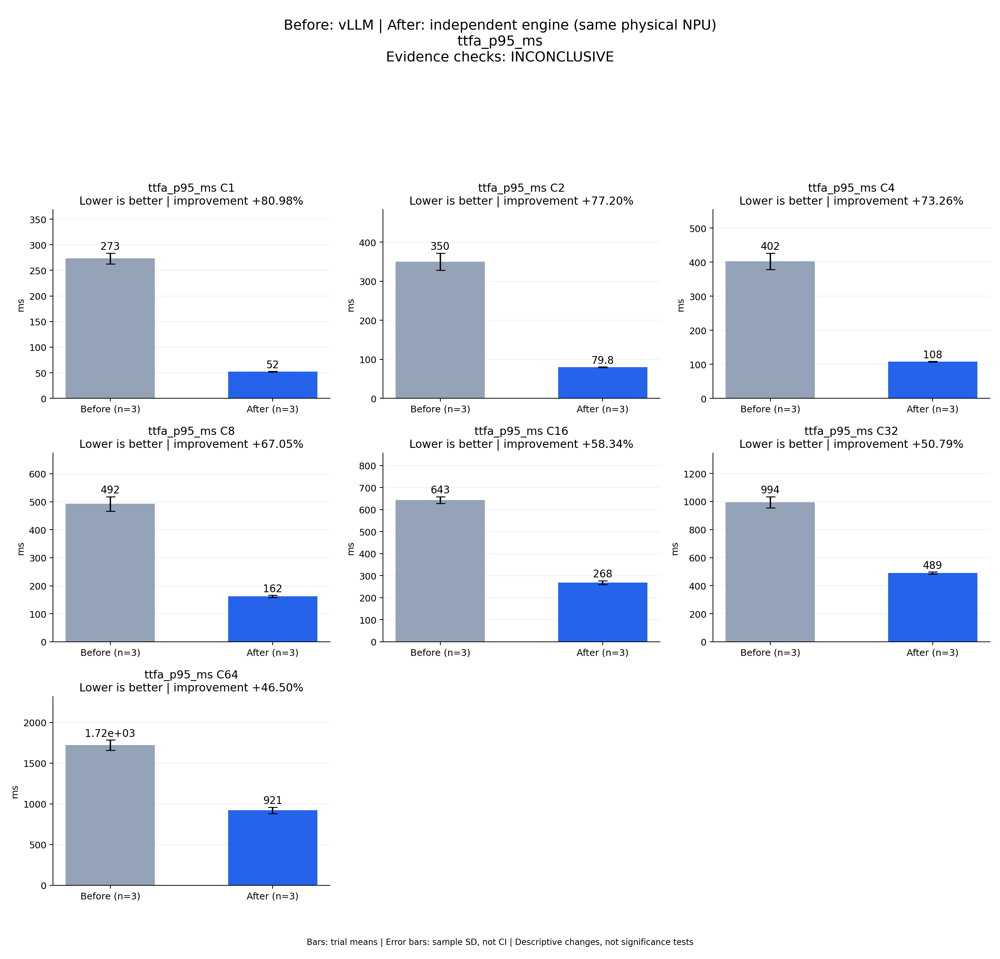

# Before: vLLM | After: independent engine (same physical NPU)
ttfa_p95_ms

Evidence checks: **INCONCLUSIVE**

PASS means supplied evidence checks passed; it does not establish a statistically significant gain.
Means are equally weighted trial means. SD is sample standard deviation, not a confidence interval.

| Metric / scenario | Direction | Before mean ± SD (n) | After mean ± SD (n) | Improvement | Scope |
|---|---|---:|---:|---:|---|
| ttfa_p95_ms / C1 (ms) | lower | 273.206 ± 10.52 (n=3) | 51.969 ± 0.581989 (n=3) | +80.98% | repeated trials |
| ttfa_p95_ms / C2 (ms) | lower | 349.794 ± 22.0747 (n=3) | 79.763 ± 0.529541 (n=3) | +77.20% | repeated trials |
| ttfa_p95_ms / C4 (ms) | lower | 402.426 ± 24.0385 (n=3) | 107.59 ± 0.903002 (n=3) | +73.26% | repeated trials |
| ttfa_p95_ms / C8 (ms) | lower | 492.492 ± 25.9176 (n=3) | 162.26 ± 3.50621 (n=3) | +67.05% | repeated trials |
| ttfa_p95_ms / C16 (ms) | lower | 643.214 ± 15.5316 (n=3) | 267.987 ± 8.56131 (n=3) | +58.34% | repeated trials |
| ttfa_p95_ms / C32 (ms) | lower | 994.406 ± 40.5509 (n=3) | 489.363 ± 7.80684 (n=3) | +50.79% | repeated trials |
| ttfa_p95_ms / C64 (ms) | lower | 1721.06 ± 62.7684 (n=3) | 920.749 ± 39.2774 (n=3) | +46.50% | repeated trials |



## Input and provenance

```json
{
  "title": "Before: vLLM | After: independent engine (same physical NPU)\nttfa_p95_ms",
  "synthetic": false,
  "context": {
    "hardware": "Ascend 910B1 physical NPU 0, one device per arm, shared host",
    "model": "Qwen3-TTS-12Hz-1.7B-CustomVoice BF16, pinned weights",
    "workload": "128 fixed requests at each C1/2/4/8/16/32/64",
    "baseline_revision": [
      "b164fea797531c1fa10f8b87829632cad006b9fc",
      "b164fea797531c1fa10f8b87829632cad006b9fc",
      "b164fea797531c1fa10f8b87829632cad006b9fc"
    ],
    "candidate_revision": [
      "e783a64b0fb4f9ade2ffb3980b3e1f74a00c9a6a",
      "e783a64b0fb4f9ade2ffb3980b3e1f74a00c9a6a",
      "e783a64b0fb4f9ade2ffb3980b3e1f74a00c9a6a"
    ],
    "source_logs": [
      "runs/vllm-sweep-round1-full128/status.json",
      "runs/vllm-sweep-round2-full128/status.json",
      "runs/vllm-sweep-round3-card0-full128/status.json",
      "runs/continuous-direct-prompt-card0-round1/status.json",
      "runs/continuous-direct-prompt-card0-round2/status.json",
      "runs/continuous-direct-prompt-card0-round3/status.json"
    ]
  },
  "checks": {
    "comparable": "unknown",
    "correctness": "unknown",
    "lifecycle": "pass"
  },
  "runs": {
    "before": {
      "completed": 2688,
      "failed": 0
    },
    "after": {
      "completed": 2688,
      "failed": 0
    }
  },
  "notes": [
    "Three independent server processes per arm; bars are means and error bars sample standard deviations, not confidence intervals.",
    "All arms used physical NPU 0; host activity was shared and trials were sequential, not randomized.",
    "Full independent candidate scoring is still running; this figure is not final acceptance.",
    "TTFA p50/p95 bars summarize per-trial percentiles, not pooled-request percentiles.",
    "vLLM is the faster measured baseline at every concurrency; all SGLang observations remain in the machine-readable comparison.",
    "Round-1 vLLM physical device is recorded in the contemporaneous campaign report; its older runner lacks the environment field."
  ],
  "metrics": [
    {
      "name": "ttfa_p95_ms",
      "unit": "ms",
      "direction": "lower",
      "scenario": "C1",
      "before": [
        284.75743043236434,
        270.6865864805877,
        264.1751538962126
      ],
      "after": [
        51.344451354816556,
        52.066443115472794,
        52.49612974002957
      ]
    },
    {
      "name": "ttfa_p95_ms",
      "unit": "ms",
      "direction": "lower",
      "scenario": "C2",
      "before": [
        374.9993046745658,
        340.47881476581097,
        333.9035087265074
      ],
      "after": [
        80.28674144297837,
        79.77434834465383,
        79.22784341499208
      ]
    },
    {
      "name": "ttfa_p95_ms",
      "unit": "ms",
      "direction": "lower",
      "scenario": "C4",
      "before": [
        430.1252225879579,
        387.02510218136007,
        390.1269230060279
      ],
      "after": [
        106.65350239723921,
        107.66108031384645,
        108.45530102960764
      ]
    },
    {
      "name": "ttfa_p95_ms",
      "unit": "ms",
      "direction": "lower",
      "scenario": "C8",
      "before": [
        520.5294966232032,
        487.53843032754946,
        469.40944171510637
      ],
      "after": [
        158.84279557503757,
        162.08830885589117,
        165.8488990273326
      ]
    },
    {
      "name": "ttfa_p95_ms",
      "unit": "ms",
      "direction": "lower",
      "scenario": "C16",
      "before": [
        661.1373523715883,
        634.7947570495307,
        633.7096572387964
      ],
      "after": [
        258.12882832251483,
        272.2789238672703,
        273.55367518030096
      ]
    },
    {
      "name": "ttfa_p95_ms",
      "unit": "ms",
      "direction": "lower",
      "scenario": "C32",
      "before": [
        1016.5279964916408,
        1019.0857470035553,
        947.6056032348424
      ],
      "after": [
        481.8922309670597,
        488.7289855163544,
        497.46726634912187
      ]
    },
    {
      "name": "ttfa_p95_ms",
      "unit": "ms",
      "direction": "lower",
      "scenario": "C64",
      "before": [
        1793.4304440394044,
        1688.375543570146,
        1681.3864248339087
      ],
      "after": [
        876.810297416523,
        932.9840525519102,
        952.4525954388081
      ]
    }
  ]
}
```
